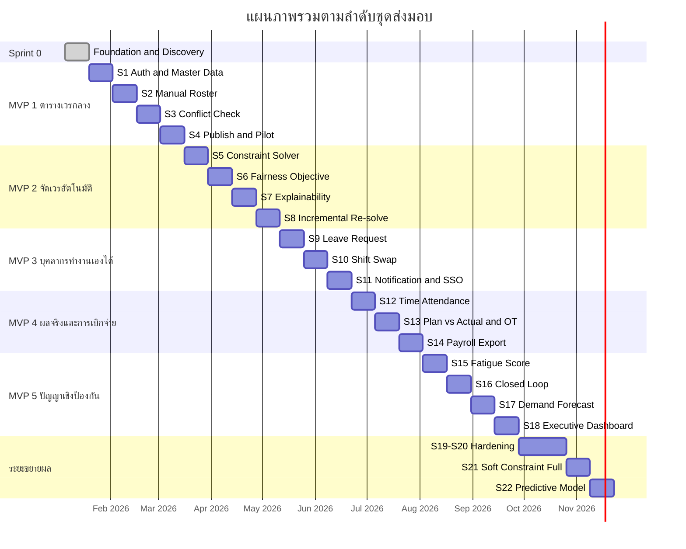

**MVP EXECUTION PLAN**

**แผนปฏิบัติงานรายละเอียดตามลำดับ MVP**

MedRota Cloud

| รายการ | รายละเอียด |
|---|---|
| **เวอร์ชัน** | 1.0.0 |
| **สถานะ** | Draft – รอการอนุมัติ |
| **วันที่จัดทำ** | 7 พฤษภาคม 2568 |
| **เอกสารอ้างอิง** | PRD_SmartNurseScheduling_v1.0.md (บริหารจัดการเวรโรงพยาบาล — MedRota Cloud) |
| **ระดับความลับ** | ภายในองค์กร (Internal) |

เอกสารนี้เป็นเอกสารประกอบของ PRD โดยขยายความจากหัวข้อ 11 Agile Delivery Roadmap ให้อยู่ในระดับที่ทีมนำไปตั้ง Sprint Backlog ได้ทันที เรียงตามลำดับชุดส่งมอบ

รหัสที่อ้างถึงในเอกสารนี้ ได้แก่ FR (ข้อกำหนดฟังก์ชัน), INT (การเชื่อมต่อระบบภายนอก), NFR (ข้อกำหนดที่ไม่ใช่ฟังก์ชัน), BP (กระบวนการทางธุรกิจ), AIP (หลักการออกแบบ AI), KPI, CON (ข้อจำกัด) และ RK (ความเสี่ยง) ใช้ความหมายตามที่นิยามไว้ใน PRD และคำย่อทางเทคนิคดูได้จากภาคผนวก Glossary ของ PRD

# 1. สมมติฐานการวางแผน

| รายการ | ค่าที่ใช้ |
|---|---|
| ความยาว Sprint | 2 สัปดาห์ |
| จำนวน Sprint รวม | Sprint 0 + 18 Sprint ถึง MVP 5 + 4 Sprint ระยะขยายผล |
| วันทำงานต่อ Sprint | 10 วัน หักเวลาสำหรับพิธีกรรมประจำ Sprint และงานสนับสนุนประมาณ 20% |
| ความเร็วทีม | ประเมินจริงหลังจบ Sprint 2 แล้วปรับแผนทุกครั้งที่จบชุดส่งมอบ |
| Environment | Dev, UAT และ Production แยกกัน พร้อมใช้ตั้งแต่จบ Sprint 0 |
| Ward นำร่อง | 2 Ward ที่มีลักษณะต่างกัน แนะนำให้เลือกหอผู้ป่วยทั่วไป 1 แห่งและหน่วยวิกฤต 1 แห่ง เพื่อให้กฎเวรที่ทดสอบครอบคลุมทั้งสองแบบ |

# 2. โครงสร้างทีม

| บทบาท | จำนวน | ช่วงที่ต้องใช้งานหนัก | ความรับผิดชอบหลัก |
|---|---|---|---|
| Product Owner | 1 | ทุก Sprint | จัดลำดับ Backlog, ตัดสินขอบเขต, ประสานผู้ใช้และผู้บริหาร |
| System Analyst / BA | 1 | Sprint 0 ถึง MVP 3 | แปลงกฎระเบียบเป็นข้อกำหนด, ดูแลเอกสารและ Traceability |
| Tech Lead / Architect | 1 | ทุก Sprint | สถาปัตยกรรม, Code Review, การตัดสินใจทางเทคนิค |
| Backend Developer | 2 | ทุก Sprint | API, Business Logic, การเชื่อมต่อระบบภายนอก |
| Frontend Developer | 1-2 | MVP 1 ถึง MVP 3 เป็นช่วงหนัก | หน้าจอ Grid ตารางเวร, Calendar, Dashboard |
| Optimization / Data Engineer | 1 | MVP 2 และ MVP 5 เป็นช่วงหนัก | Constraint Model และ Solver, โมเดลคาดการณ์ (Python); Fatigue Score (Python หรือ NestJS ตาม ADR) |
| QA Engineer | 1 | ตั้งแต่ Sprint 1 | Test Case, Automated Test, ประสาน UAT |
| UX Designer | 1 (ไม่เต็มเวลา) | Sprint 0 ถึง MVP 1 และช่วง MVP 5 | Wireframe, Prototype, Executive Dashboard |

**ข้อสังเกตเรื่องการจัดคน** ตำแหน่ง Optimization / Data Engineer เป็นทักษะเฉพาะที่หาได้ยากกว่าตำแหน่งอื่น ควรเริ่มสรรหาหรือจัดเตรียมไว้ตั้งแต่ Sprint 0 เพราะต้องพร้อมใช้งานเต็มเวลาใน Sprint 5 ซึ่งเป็นจุดเริ่มของ MVP 2

# 3. Definition of Ready และ Definition of Done

**Definition of Ready** — เงื่อนไขที่รายการงานต้องมีครบก่อนรับเข้า Sprint

- มีรหัส FR หรือ BP ที่อ้างอิงได้ และระบุผู้ใช้ที่ได้ประโยชน์
- มีเกณฑ์ยอมรับ (Acceptance Criteria) ที่ทดสอบได้เป็นข้อ ๆ
- กฎธุรกิจที่เกี่ยวข้องถูกยืนยันจาก Product Owner แล้ว ไม่มีข้อที่ยังเป็นคำถามค้าง
- ประเมินขนาดงานโดยทีมแล้ว และไม่มีสิ่งที่ต้องรอจากภายนอกเป็นเงื่อนไขเริ่มงาน

**Definition of Done** — เงื่อนไขที่ถือว่างานเสร็จ ใช้ร่วมกันทุก Sprint

- ผ่านเกณฑ์ยอมรับทุกข้อ และผ่าน Code Review
- มี Automated Test ครอบคลุม Core Business Logic และ Code Coverage รวมไม่ต่ำกว่า 70% ตาม NFR-06
- บันทึก Audit Log ครบทุก Transaction ที่เปลี่ยนแปลงข้อมูลตาม NFR-03
- ผ่านการทดสอบบน Desktop, Tablet และ Mobile ตาม NFR-07
- Deploy ขึ้น UAT ได้ด้วย Pipeline โดยไม่ต้องทำด้วยมือ
- เอกสารที่เกี่ยวข้องอัปเดตแล้ว ได้แก่ Traceability Matrix และ API Specification
- สำหรับงานที่เกี่ยวกับ AI ต้องมีคำอธิบายเหตุผลที่ผู้ใช้เปิดดูได้ตาม AIP-01 ครบทุกผลลัพธ์

# 4. พิธีกรรมประจำ Sprint

| พิธีกรรม | ความถี่ | ผู้เข้าร่วม | ผลลัพธ์ |
|---|---|---|---|
| Sprint Planning | ต้น Sprint | ทีมทั้งหมด | Sprint Goal และ Sprint Backlog |
| Daily Stand-up | ทุกวัน 15 นาที | ทีมพัฒนา | สิ่งกีดขวางที่ต้องแก้ภายในวัน |
| Backlog Refinement | กลาง Sprint | PO, SA, Tech Lead, QA | รายการงานที่ผ่าน Definition of Ready สำหรับ Sprint ถัดไป |
| Sprint Review | ท้าย Sprint | ทีม + หัวหน้าตึกและ Admin ของ Ward นำร่อง | เสียงตอบรับจากผู้ใช้จริงบนของที่ใช้งานได้ ไม่ใช่บนสไลด์ |
| Sprint Retrospective | ท้าย Sprint | ทีมทั้งหมด | สิ่งที่จะปรับใน Sprint ถัดไป 1-2 ข้อ |
| Release Readiness Review | ท้ายทุกชุดส่งมอบ | ทีม + PO + ผู้บริหารกองการพยาบาล | ผลวัดตัวชี้วัดและการตัดสิน Go/No-Go |

# 5. Sprint 0 — Foundation & Discovery (สัปดาห์ที่ 1-2)

**เป้าหมาย** ยืนยันกฎธุรกิจและเตรียมฐานเทคนิคให้ทีมเริ่มพัฒนาได้ทันทีใน Sprint 1

| งาน | อ้างอิง | ผลที่ต้องได้ |
|---|---|---|
| Workshop ยืนยันกฎระเบียบเวรจริง แล้วแปลงเป็น Hard Constraint และ Soft Constraint พร้อมค่าน้ำหนักเริ่มต้น | FR-A07, FR-AI01 | ตารางกฎที่ลงนามยืนยัน แยกชัดว่าข้อใดห้ามละเมิดและข้อใดเป็นความพึงพอใจ |
| สอบเทียบปัจจัยและน้ำหนักของ Fatigue Score กับหัวหน้าตึก | FR-AI03 | ชุดน้ำหนักเริ่มต้นและเกณฑ์เตือนแยกตามประเภทหอผู้ป่วย |
| กำหนดนโยบายระดับความเสี่ยง P50 หรือ P90 ต่อประเภทหอผู้ป่วย | FR-AI02 | ตารางนโยบายที่ผู้บริหารอนุมัติ |
| ออกแบบ Database Schema และสถาปัตยกรรม พร้อมตัดสินใจเรื่อง Multi-Tenant ตั้งแต่ต้น | NFR-05 | Schema, Architecture Decision Record |
| Spike ตรวจความเป็นไปได้ของ API ระบบลงเวลางานและ HIS | INT-01, INT-06, CON-01, CON-02 | คำตอบชัดเจนว่าใช้ API ได้หรือต้องใช้เส้นทางนำเข้าไฟล์ |
| Spike บริการ Python: Solver (OR-Tools CP-SAT) และพยากรณ์ (LightGBM) วัดเวลาและความถูกต้องกับโจทย์ 80 คน × 31 วัน, สัญญา API ระหว่าง NestJS กับ Python และเวลาเรียกบริการ, ตรวจข้อจำกัดของ Web Push บนอุปกรณ์ที่ใช้จริง | FR-AI01, FR-AI02, FR-A10, FR-U08, NFR-01, RK-08 | ผลวัดจริงและ ADR ของสถาปัตยกรรม 2 บริการ (ขอบเขตของ Python, การ Deploy, สัญญา API) |
| Wireframe หน้าจอหลัก ได้แก่ Grid ตารางเวร, Calendar ส่วนตัว, หน้าอนุมัติ | FR-A08, FR-U05 | Prototype ที่ผู้ใช้กดลองได้ |
| ตั้ง Repository, CI/CD, Environment และโครง Audit Log | NFR-03, NFR-06 | Pipeline ที่ Deploy ขึ้น UAT ได้จริง |
| จัดทำ DPIA ฉบับร่างและแผนรองรับ PDPA | CON-04 | ร่าง DPIA ที่ส่งให้ผู้รับผิดชอบด้านข้อมูลส่วนบุคคลพิจารณา |
| เลือก Ward นำร่องและนัดตารางร่วม Sprint Review | — | รายชื่อ Ward และผู้ประสานงานที่ยืนยันแล้ว |

**ความเสี่ยงที่ต้องเฝ้าระวังใน Sprint นี้** หาก Spike พบว่าระบบลงเวลางานไม่มี API ต้องปรับขอบเขต MVP 4 ให้ใช้เส้นทางนำเข้าไฟล์เป็นทางหลักตั้งแต่ต้น (RK-03) และหากกฎระเบียบยังไม่ชัดเจนพอ ให้ยืด Sprint 0 ออกไปแทนการเริ่มพัฒนาบนกฎที่ไม่แน่นอน เพราะกฎเหล่านี้จะกลายเป็นแกนของ Solver ใน MVP 2

# 6. MVP 1 — ตารางเวรกลางที่เชื่อถือได้ (สัปดาห์ที่ 3-10)

**คุณค่าที่ส่งมอบ** Ward นำร่องเลิกใช้ Excel ได้จริง ตารางเวรมีแหล่งข้อมูลเดียว และระบบตรวจกฎแทนคน

## Sprint 1 (สัปดาห์ที่ 3-4) — เข้าระบบได้และข้อมูลหลักพร้อมใช้

| งาน | อ้างอิง |
|---|---|
| จัดการผู้ใช้งาน เพิ่ม แก้ไข ระงับบัญชี กำหนดบทบาทและสังกัด | FR-A01 |
| Role-Based Access Control 4 บทบาท SuperAdmin, WardAdmin, HeadNurse, Nurse | FR-A02 |
| จัดการข้อมูล Ward, Department, อาคาร, ประเภทหอผู้ป่วย | FR-A04 |
| จัดการข้อมูลโรงพยาบาลและนโยบายการขึ้นเวรระดับองค์กร | FR-A05 |
| Authentication พื้นฐาน JWT พร้อม Refresh Token และ Password Policy | NFR-02 |
| โครง Audit Log ที่บันทึกทุกการเปลี่ยนแปลงข้อมูลหลัก | NFR-03 |

**ผลส่งมอบที่สาธิตได้** ผู้ใช้ 4 บทบาทเข้าระบบได้และเห็นเมนูตามสิทธิ์ของตน; Admin จัดการข้อมูลหลักได้ครบ

## Sprint 2 (สัปดาห์ที่ 5-6) — สร้างตารางเวรด้วยมือได้และกฎอยู่ในระบบ

| งาน | อ้างอิง |
|---|---|
| จัดการประเภทเวรและอัตราค่าตอบแทนต่อประเภทเวร | FR-A06 |
| บันทึกกฎระเบียบเวรลงระบบ พร้อมโครงสร้างข้อมูลที่แยก Hard และ Soft Constraint ไว้ตั้งแต่ต้น | FR-A07 |
| หน้าจอ Grid ตารางเวรรายเดือน พร้อมการกำหนดเวรด้วย Drag-and-Drop | FR-A08 ส่วน Manual |
| แสดงสรุปจำนวนเวรและชั่วโมงรายบุคคลข้างตาราง เพื่อให้ Admin มองเห็นความสมดุลระหว่างทำงาน | FR-A08 |

**ผลส่งมอบที่สาธิตได้** Admin สร้างตารางเวร 1 เดือนของ Ward นำร่องด้วยมือได้ครบทุกช่อง

**ข้อควรระวังทางเทคนิค** โครงสร้างข้อมูลของกฎใน Sprint นี้คือสิ่งที่ MVP 2 จะนำไปใช้เป็นโมเดลของ Solver ควรออกแบบให้แสดงกฎเป็นข้อจำกัดเชิงปริมาณได้ตั้งแต่ต้น ไม่ฝังเป็นเงื่อนไขในโค้ดหน้าจอ

## Sprint 3 (สัปดาห์ที่ 7-8) — ระบบตรวจกฎแทนคน

| งาน | อ้างอิง |
|---|---|
| ตรวจความขัดแย้งของตารางเวรกับกฎระเบียบทุกข้อ ในโหมดตรวจสอบ | FR-A10 |
| แสดงผลการตรวจแบบชี้ตำแหน่งที่ผิดบนตาราง พร้อมระบุกฎที่ถูกละเมิด | FR-A10 |
| แก้ไขตารางเวรที่ยังไม่ประกาศใช้ พร้อมบันทึก Change Log ผู้แก้ไขและเวลา | FR-A09 |
| ชุดข้อมูลทดสอบจากตารางเวรจริงย้อนหลังของ Ward นำร่อง เพื่อตรวจว่าระบบจับกฎได้ครบ | KPI-04 |

**ผลส่งมอบที่สาธิตได้** ตารางที่ผิดกฎถูกจับได้ก่อนบันทึกทุกกรณี และวัดอัตราการตรวจพบได้เทียบกับชุดข้อมูลทดสอบ

**หมายเหตุสำคัญ** งานใน Sprint นี้คือการสร้างแบบจำลองเงื่อนไข (Constraint Model) ในโหมดตรวจสอบ ซึ่ง MVP 2 จะนำโมเดลเดียวกันไปใช้ในโหมดค้นหาคำตอบ จึงไม่ใช่งานที่ทำแล้วทิ้ง

## Sprint 4 (สัปดาห์ที่ 9-10) — ประกาศใช้ บุคลากรเห็นตาราง และเปิดใช้นำร่อง

| งาน | อ้างอิง |
|---|---|
| Workflow การอนุมัติตารางเวร Draft ถึง Review ถึง Approved ถึง Published | FR-A11 |
| มุมมองพยาบาล ดูตารางเวรของแผนกแบบ Monthly และ List View | FR-U01 |
| มุมมองพยาบาล ดูตารางเวรส่วนตัวพร้อมสรุปชั่วโมงและจำนวนเวร | FR-U02 |
| Personal Calendar แสดงเวร วันหยุด และกิจกรรมของแผนก | FR-U05 |
| รายงานสรุปตารางเวรประจำเดือน พร้อมพิมพ์และส่งออก PDF และ Excel | FR-R01 |
| UAT กับผู้ใช้จริงและเปิดใช้งานนำร่อง 2 Ward | — |

**ผลส่งมอบที่สาธิตได้** ครบวงจร BP-01 เส้นทาง Manual ตั้งแต่สร้างตารางจนประกาศใช้และบุคลากรเห็นเวรของตนเอง

**เกณฑ์ปิดชุดส่งมอบ** วัด KPI-01, KPI-03, KPI-04 และเฝ้าดูการใช้งานจริง 1 เดือนก่อนตัดสิน Go/No-Go เข้าสู่ MVP 2

# 7. MVP 2 — จัดเวรอัตโนมัติที่อธิบายได้ (สัปดาห์ที่ 11-18)

**คุณค่าที่ส่งมอบ** ลดเวลาจัดเวรจากหลายชั่วโมงเหลือไม่เกิน 5 นาที และรับประกันว่าไม่มีตารางที่ผิดกฎหลุดไปถึงบุคลากร

## Sprint 5 (สัปดาห์ที่ 11-12) — Solver คืนตารางที่ผ่านเงื่อนไขบังคับได้

| งาน | อ้างอิง |
|---|---|
| นำแบบจำลองเงื่อนไขจาก MVP 1 (ซึ่งอยู่ในบริการ Python อยู่แล้วตั้งแต่ FR-A10) มาต่อเป็นโมเดลของ OR-Tools CP-SAT | FR-AI01 |
| รัน Solver เป็น Asynchronous Job ในบริการ Python (NestJS ส่งงานและรับผลผ่าน Job Queue) พร้อมกรอบเวลาประมวลผล | FR-AI01, NFR-01 |
| ทดสอบกับข้อมูลจริงของ Ward นำร่องทั้งสองแบบ และวัดเวลาประมวลผล | — |

**ผลส่งมอบที่สาธิตได้** ระบบคืนตารางที่ผ่าน Hard Constraint ทุกข้อได้ แม้ยังไม่ได้ปรับให้เป็นธรรมหรือสวยงาม

**ความเสี่ยงที่ต้องเฝ้าระวัง** Sprint นี้เป็นจุดที่ประเมินเวลายากที่สุดของโครงการ หากเวลาประมวลผลยังไม่เข้าเกณฑ์ ให้ลดขนาดปัญหาก่อน เช่น จัดเวรรายสัปดาห์แล้วต่อกัน ก่อนตัดสินใจเปลี่ยนเทคนิค

## Sprint 6 (สัปดาห์ที่ 13-14) — ตารางที่เสนอมีความเป็นธรรมที่วัดได้

| งาน | อ้างอิง |
|---|---|
| Soft Constraint ชุดแรก ได้แก่ ความเป็นธรรมของเวรดึกและเวรวันหยุด และความต่อเนื่องของรูปแบบเวร | FR-AI01 |
| Objective Function แบบถ่วงน้ำหนัก และหน้าตั้งค่าน้ำหนักสำหรับผู้บริหาร | FR-AI01, CON-03 |
| แสดง Fairness Index และ Gini Coefficient บนหน้าผลลัพธ์ | KPI, BO-04 |

**ผลส่งมอบที่สาธิตได้** ผู้บริหารปรับน้ำหนักเงื่อนไขแล้วเห็นผลต่างของตารางที่ได้ทันที พร้อมตัวเลขความเป็นธรรม

## Sprint 7 (สัปดาห์ที่ 15-16) — ระบบอธิบายได้ว่าทำไม และบอกได้ว่าทำไมไม่ได้

| งาน | อ้างอิง |
|---|---|
| Explainability Layer แสดงเหตุผลรายช่อง และผลกระทบหากเปลี่ยนตัวบุคคล | FR-AI01, AIP-01 |
| Explainability Store จัดเก็บเหตุผลเพื่อการตรวจสอบย้อนหลัง | AIP-01, NFR-03 |
| การวินิจฉัยกรณีหาคำตอบไม่ได้ ระบุชุดเงื่อนไขที่ขัดแย้งและเสนอทางเลือกคลายเงื่อนไข | BP-01 EX-1 |

**ผลส่งมอบที่สาธิตได้** คลิกช่องใดก็ได้แล้วเห็นเหตุผล; กรณีจัดไม่ได้ ระบบบอกว่าขัดกันที่เงื่อนไขใดและเสนอทางออก

## Sprint 8 (สัปดาห์ที่ 17-18) — ใช้งานจริงและปรับเฉพาะจุดได้

| งาน | อ้างอิง |
|---|---|
| Incremental Re-solve จัดเวรใหม่เฉพาะช่วงที่ได้รับผลกระทบ | FR-AI01 |
| เชื่อมปุ่ม Auto-suggest เข้าหน้าจอสร้างตารางเวร | FR-A08 |
| ปรับสมรรถนะให้เข้าเกณฑ์ไม่เกิน 60 วินาทีสำหรับ Ward ขนาด 80 คน 31 วัน | NFR-01 |
| UAT และวัดเวลาที่ Admin ใช้จัดเวรจริงเทียบกับค่าฐานที่เก็บไว้ใน Sprint 0 | KPI |

**ผลส่งมอบที่สาธิตได้** ครบวงจร BP-01 เส้นทาง AI และวัดผลลดเวลาจัดเวรได้เป็นตัวเลข

# 8. MVP 3 — บุคลากรทำงานผ่านมือถือได้ (สัปดาห์ที่ 19-24)

**คุณค่าที่ส่งมอบ** พยาบาลยื่นลาและแลกเวรเองได้ผ่านมือถือ และ Admin ลดงานกระดาษ

## Sprint 9 (สัปดาห์ที่ 19-20) — ยื่นลาและอนุมัติได้ครบวงจร

| งาน | อ้างอิง |
|---|---|
| ยื่นใบลาออนไลน์ ระบุประเภท ช่วงวันที่ เหตุผล และแนบเอกสาร | FR-U04 |
| ตรวจสิทธิวันลาคงเหลือและความครบถ้วนของเอกสารด้วยกฎธุรกิจ | BP-03 ขั้นที่ 2 |
| อนุมัติหรือปฏิเสธใบลาพร้อมเหตุผล และอัปเดตตารางเวรอัตโนมัติ | FR-A13 |
| เชื่อม Incremental Re-solve เข้ากระบวนการลา เพื่อเสนอผู้รับเวรแทน | FR-AI01, BP-03 |
| เส้นทางเร่งด่วนสำหรับลาป่วยฉุกเฉินในวันที่มีเวร | BP-03 EX-2 |

**ผลส่งมอบที่สาธิตได้** ครบวงจร BP-03 ตั้งแต่ยื่นใบลาจนตารางเวรปรับแทนและแจ้งผู้เกี่ยวข้อง

## Sprint 10 (สัปดาห์ที่ 21-22) — แลกเวรครบวงจร

| งาน | อ้างอิง |
|---|---|
| ยื่นคำขอแลกเวร พร้อมระบบคัดกรองเฉพาะผู้มีคุณสมบัติที่แลกได้จริง | FR-U03, BP-02 ขั้นที่ 2 |
| ตรวจผลกระทบต่อเงื่อนไขบังคับของทั้งสองฝ่ายก่อนเสนอให้อนุมัติ | FR-AI01, BP-02 ขั้นที่ 4 |
| อนุมัติการแลกเวรและบันทึกประวัติทุกครั้ง | FR-A12 |
| รายงานประวัติการแลกเวรและรายงานวิเคราะห์การลาหยุด | FR-R07, FR-R08 |

**ผลส่งมอบที่สาธิตได้** ครบวงจร BP-02 รวมกรณีที่ผลตรวจไม่ผ่านและระบบเสนอผู้อื่นแทน

## Sprint 11 (สัปดาห์ที่ 23-24) — แจ้งเตือน เข้าใช้งานง่าย และขยาย Ward

| งาน | อ้างอิง |
|---|---|
| ระบบแจ้งเตือนผ่าน In-app, Email และ SMS พร้อมการส่งซ้ำเมื่อช่องทางใดล้มเหลว | FR-A15, INT-07 |
| รับการแจ้งเตือนบนมือถือ และ Notification Center รวมทุกประเภท | FR-U08 |
| เข้าสู่ระบบด้วยบัญชี Google, Microsoft และ Facebook | INT-03, INT-04, INT-05, TO-03 |
| เปิดปิดเมนูตามบทบาทแบบ Dynamic Menu | FR-A03 |
| ทดสอบและปรับ Web Application แบบ Mobile-First บนอุปกรณ์มือถือจริงที่บุคลากรใช้ | TO-04, NFR-07 |
| UAT และขยายการใช้งานเพิ่มเป็น 5-6 Ward | — |

**ผลส่งมอบที่สาธิตได้** พยาบาลใช้งานครบวงจรบนมือถือของตนเองตั้งแต่เข้าสู่ระบบจนรับการแจ้งเตือน

# 9. MVP 4 — ความจริงจากหน้างานและการเบิกจ่ายที่แม่นยำ (สัปดาห์ที่ 25-30)

**คุณค่าที่ส่งมอบ** ค่าล่วงเวลาคำนวณจากการขึ้นเวรจริง ลดข้อโต้แย้ง และปิดรอบเดือนได้ตรงเวลา ตอบวัตถุประสงค์ BO-03 โดยตรง

## Sprint 12 (สัปดาห์ที่ 25-26) — ดึงข้อมูลการขึ้นเวรจริงเข้าระบบได้

| งาน | อ้างอิง |
|---|---|
| เชื่อมต่อระบบลงเวลางานเพื่อดึงข้อมูล Clock-in และ Clock-out รายวัน | INT-01 |
| เส้นทางสำรองนำเข้าไฟล์ CSV หรือ Excel สำหรับกรณีไม่มี API | RK-03, BP-04 ขั้นที่ 1 |
| กฎการตีความข้อมูลลงเวลาที่ไม่สมบูรณ์ เช่น ลงไม่ครบคู่ หรือเวรข้ามเที่ยงคืน | BP-04 ขั้นที่ 2 |
| หน้าตรวจสอบคุณภาพข้อมูลที่นำเข้า พร้อมรายการที่ระบบกันออกจากการคำนวณ | BP-04 EX-1 |

**ผลส่งมอบที่สาธิตได้** ข้อมูลการขึ้นเวรจริงของเดือนที่ผ่านมาเข้าระบบได้ครบ และรายการที่มีปัญหาถูกแยกออกอย่างชัดเจน

## Sprint 13 (สัปดาห์ที่ 27-28) — เทียบแผนกับผลจริงและคำนวณค่าล่วงเวลา

| งาน | อ้างอิง |
|---|---|
| จับคู่เวรที่วางแผนกับการขึ้นเวรจริง และแสดงส่วนต่างรายบุคคล | FR-U06, BP-04 ขั้นที่ 2 |
| รายงานกำลังคนประจำเดือนเทียบแผนกับผลจริง พร้อมค่า Variance | FR-R02 |
| คำนวณชั่วโมง OT และค่าตอบแทนตามประเภทเวร | FR-A14 |
| Workflow ตรวจและอนุมัติรายการเบิก พร้อมช่องทางให้บุคลากรชี้แจงส่วนต่าง | FR-A14, BP-04 ขั้นที่ 3-4 |

**ผลส่งมอบที่สาธิตได้** หัวหน้าตึกเห็นส่วนต่างระหว่างแผนกับผลจริงทุกรายการ และตัดสินรายการเบิกได้ในระบบ

## Sprint 14 (สัปดาห์ที่ 29-30) — ส่งออกให้ Payroll และปิดรอบได้

| งาน | อ้างอิง |
|---|---|
| รายงานเบิก-จ่ายค่าล่วงเวลาและไฟล์ส่งออกตามรูปแบบที่ระบบ Payroll กำหนด | FR-R03, INT-02 |
| มุมมองพยาบาลดูสรุปค่าล่วงเวลาของตนเองพร้อมสถานะการอนุมัติ | FR-U07 |
| กลไกรายการปรับปรุงสำหรับรอบที่ปิดแล้ว โดยไม่แก้ย้อนหลัง | BP-04 EX-2 |
| ทดสอบปิดรอบคู่ขนานกับวิธีเดิม 1 เดือนเต็ม และเทียบผลทุกรายการ | KPI-06 |

**ผลส่งมอบที่สาธิตได้** ปิดรอบเดือนด้วยระบบและเทียบผลกับวิธีเดิมได้ตรงกัน พร้อมส่งไฟล์ให้ฝ่ายการเงิน

**เกณฑ์ปิดชุดส่งมอบ** การทดสอบคู่ขนานต้องผ่าน 2 เดือนติดกันก่อนเลิกใช้วิธีเดิม เพราะเป็นงานที่เกี่ยวกับเงินเดือนของบุคลากรโดยตรง

# 10. MVP 5 — ปัญญาเชิงป้องกันและภาพรวมผู้บริหาร (สัปดาห์ที่ 31-38)

**คุณค่าที่ส่งมอบ** ป้องกันความเหนื่อยล้าก่อนเกิดเหตุ วางแผนกำลังคนล่วงหน้า 1-2 เดือน และผู้บริหารเห็นภาพรวมทั้งกอง

## Sprint 15 (สัปดาห์ที่ 31-32) — Fatigue Score ชั้นที่ 1

| งาน | อ้างอิง |
|---|---|
| คำนวณ Fatigue Score รายบุคคลจากตารางและการขึ้นเวรจริง ด้วยน้ำหนักที่สอบเทียบใน Sprint 0 | FR-AI03 ชั้นที่ 1 |
| เกณฑ์เตือนแยกตามประเภทหอผู้ป่วย และการแจ้งเตือนพร้อมระบุปัจจัยที่เป็นสาเหตุ | FR-AI03, AIP-01 |
| การจำกัดสิทธิ์การเข้าถึงคะแนนตามมาตรการกำกับดูแลด้านจริยธรรม | FR-AI03 Ethical Guardrails |
| รายงานวิเคราะห์ความเหนื่อยล้าระดับบุคคลและระดับแผนก | FR-R04 |

**ผลส่งมอบที่สาธิตได้** หัวหน้าตึกเห็นผู้ที่มีความเสี่ยงและทราบว่าเกิดจากปัจจัยใด; ผู้บริหารเห็นเฉพาะภาพรวมระดับแผนก

## Sprint 16 (สัปดาห์ที่ 33-34) — ปิดวงจรกลับเข้า Solver

| งาน | อ้างอิง |
|---|---|
| ส่ง Fatigue Score กลับเป็น Soft Constraint ของการจัดเวรรอบถัดไป | FR-AI01, FR-AI03 |
| ครบกระบวนการ BP-05 รวมการบันทึกเหตุผลเมื่อหัวหน้าตึกเลือกไม่ปรับเวร | BP-05 |
| การยกระดับเมื่อพบผู้เกินเกณฑ์หลายรายพร้อมกัน ซึ่งเป็นสัญญาณเชิงโครงสร้าง | BP-05 EX-2 |
| เส้นทางสำรองเมื่อข้อมูลการขึ้นเวรจริงมาไม่ครบ ให้คำนวณจากแผนและกำกับว่าเป็นค่าประมาณ | BP-05 EX-1 |

**ผลส่งมอบที่สาธิตได้** ตารางเวรรอบใหม่หลีกเลี่ยงรูปแบบที่ผลักคะแนนความเหนื่อยล้าของผู้ใดเกินเกณฑ์ได้จริง

## Sprint 17 (สัปดาห์ที่ 35-36) — คาดการณ์ความต้องการกำลังคน

| งาน | อ้างอิง |
|---|---|
| เชื่อมต่อ HIS เพื่อดึงข้อมูล Census ย้อนหลังและนัดหมายล่วงหน้า | INT-06 |
| แบบจำลองฐานและโมเดล Gradient Boosting พร้อม Feature เชิงปฏิทินและฤดูกาลของโรค | FR-AI02 |
| ค่าคาดการณ์ระดับ P50 และ P90 แปลงเป็นจำนวน FTE ที่ต้องการแยกตามระดับและประเภทเวร | FR-AI02 |
| Feature Importance ประกอบการคาดการณ์ และ Model Registry เก็บเวอร์ชันโมเดล | AIP-01 |
| รายงานคาดการณ์กำลังคนและรายงานส่วนต่างระหว่างกำลังคนที่มีกับที่ต้องการ | FR-R05 |

**ผลส่งมอบที่สาธิตได้** ผู้บริหารเห็นว่าเดือนถัดไปแต่ละ Ward ต้องการกำลังคนเท่าใด ขาดเท่าใด และตัวเลขนั้นมาจากปัจจัยใด

## Sprint 18 (สัปดาห์ที่ 37-38) — ภาพรวมผู้บริหารและวัดผลรวม

| งาน | อ้างอิง |
|---|---|
| Executive Dashboard แสดง Nurse-to-Patient Ratio, OT Cost, Absenteeism Rate และ Turnover Rate | FR-R06 |
| หน้าติดตามความแม่นยำของการคาดการณ์ เทียบค่าคาดการณ์กับค่าจริงรายเดือน | FR-AI02 ขั้นที่ 5 |
| เชื่อมค่าคาดการณ์เข้าเป็น Input ของการจัดเวรรอบถัดไป | FR-AI01, FR-AI02 |
| วัดตัวชี้วัดทั้งชุด KPI-01 ถึง KPI-08 และทำ Satisfaction Survey | KPI-08 |

**ผลส่งมอบที่สาธิตได้** วงจรปิดของ AI ทำงานครบตั้งแต่คาดการณ์ จัดเวร ประเมินความเหนื่อยล้า และย้อนกลับเข้าการจัดเวรรอบถัดไป

# 11. ระยะขยายผล (สัปดาห์ที่ 39-46)

ระยะนี้ไม่ใช่ชุดส่งมอบคุณค่าใหม่ แต่เป็นการขยายการใช้งานและเสริมความแข็งแรงของระบบ

| Sprint | เป้าหมาย | งานหลัก | อ้างอิง |
|---|---|---|---|
| **Sprint 19-20** | รองรับการใช้งานทั้งองค์กรอย่างมั่นคง | Multi-Tenant Hardening; Disaster Recovery และการสำรองข้อมูลตามเกณฑ์; Penetration Testing; ปรับสมรรถนะรองรับผู้ใช้พร้อมกัน 200 คน | NFR-01, NFR-04, NFR-05, NFR-08, RK-05 |
| **Sprint 21** | ตารางเวรตอบความต้องการส่วนตัวได้ดีขึ้น | Soft Constraint ครบถ้วนรวมความต้องการส่วนตัวที่บุคลากรแจ้งไว้; การเรียนรู้รูปแบบความพึงพอใจจากประวัติการอนุมัติ | FR-AI01 ส่วนขยาย |
| **Sprint 22** | ยกระดับการทำนายความเสี่ยงและทางเลือกบนมือถือ | โมเดลทำนายความเสี่ยงรายบุคคลเมื่อข้อมูลครบ 6-12 เดือน; ปรับปรุงประสบการณ์ใช้งาน Web Application บนมือถือ | FR-AI03 ชั้นที่ 2 |

# 12. แผนภาพรวมตามเวลา

วันที่ในแผนภาพเป็นวันสมมติเพื่อแสดงสัดส่วนเวลาเท่านั้น ให้เลื่อนทั้งแผนตามวันเริ่มโครงการจริง

# 13. Traceability: ข้อกำหนดทั้งหมดเทียบกับชุดส่งมอบ

ตารางนี้แสดงว่าข้อกำหนดทุกรายการที่นิยามไว้ใน PRD ถูกจัดเข้าชุดส่งมอบใด เพื่อยืนยันว่าไม่มีรายการใดตกหล่น

| กลุ่มข้อกำหนด | Sprint 0 | MVP 1 | MVP 2 | MVP 3 | MVP 4 | MVP 5 | ขยายผล |
|---|---|---|---|---|---|---|---|
| **Admin (FR-A)** | — | A01, A02, A04, A05, A06, A07, A08 (Manual), A09, A10, A11 | A08 (Auto-suggest) | A03, A12, A13, A15 | A14 | — | — |
| **User (FR-U)** | — | U01, U02, U05 | — | U03, U04, U08 | U06, U07 | — | — |
| **Reports (FR-R)** | — | R01 | — | R07, R08 | R02, R03 | R04, R05, R06 | — |
| **AI (FR-AI)** | สอบเทียบน้ำหนักและนโยบาย P50/P90 | — | AI01 (Hard Constraint, Fairness, Explainability, Re-solve) | — | — | AI02, AI03 ชั้นที่ 1 | AI01 ส่วนขยาย, AI03 ชั้นที่ 2 |
| **Integration (INT)** | Spike INT-01, INT-06 | — | — | INT-03, INT-04, INT-05, INT-07 | INT-01, INT-02 | INT-06 | — |
| **NFR** | NFR-05 (ออกแบบ), NFR-06 | NFR-02, NFR-03, NFR-07 | NFR-01 (Solver) | — | NFR-01 (รายงาน) | — | NFR-04, NFR-05 (ขยาย), NFR-08 |
| **กระบวนการ (BP)** | — | BP-01 Manual | BP-01 AI | BP-02, BP-03 | BP-04 | BP-05 | — |

**สรุปความครบถ้วน** ข้อกำหนดฟังก์ชัน 34 รายการ, การเชื่อมต่อระบบภายนอก 7 รายการ, ข้อกำหนดที่ไม่ใช่ฟังก์ชัน 8 รายการ และกระบวนการหลัก 5 กระบวนการ ถูกจัดเข้าชุดส่งมอบครบทุกรายการ

# 14. จุดตัดสินใจที่ต้องเตรียมคำตอบล่วงหน้า

| จุดตัดสินใจ | ต้องตัดสินเมื่อ | ทางเลือกและผลที่ตามมา |
|---|---|---|
| ระบบลงเวลางานไม่มี API | จบ Sprint 0 | เลือกเส้นทางนำเข้าไฟล์เป็นทางหลัก ซึ่งเพิ่มงานด้านการตรวจคุณภาพข้อมูลใน Sprint 12 หรือเจรจาให้เจ้าของระบบพัฒนา API ซึ่งกระทบกำหนดเวลา MVP 4 |
| Spike บริการ Python ใน Sprint 0 ไม่ผ่านเกณฑ์ (เวลาเกิน 60 วินาที, MAPE เกินเกณฑ์ หรือเวลาเรียกบริการกระทบ NFR-01) | จบ Sprint 0 | ปรับขนาดโจทย์/ทรัพยากรเครื่อง หรือทบทวนขอบเขตก่อนเริ่ม Sprint 5 และปรับแผน MVP 2 |
| Solver ไม่เข้าเกณฑ์เวลาประมวลผล | จบ Sprint 5 | ลดขนาดปัญหาด้วยการจัดเวรรายสัปดาห์แล้วต่อกัน, ยอมรับกรอบเวลาที่ยาวขึ้นโดยทำงานแบบ Background, หรือทบทวนเทคนิคซึ่งกระทบกำหนดเวลา MVP 2 ทั้งชุด |
| ข้อมูล Census ย้อนหลังไม่ถึง 24 เดือนหรือคุณภาพต่ำ | จบ Sprint 17 | คงใช้รายงานเชิงสถิติแทนการคาดการณ์ และเลื่อน FR-AI02 ออกไปจนข้อมูลเพียงพอ ตาม RK-07 |
| ช่องทางแจ้งเตือนสำหรับ Web Application (ตัดสินแล้วว่าไม่พัฒนา Native App) | ก่อนเริ่ม Sprint 11 | Web Push ใช้ได้ไม่ครบทุกอุปกรณ์ จึงใช้การแจ้งเตือนภายในระบบ + SMS + อีเมลเป็นช่องหลัก และให้ Web Push เป็นช่องเสริม โดยผลตรวจข้อจำกัดอุปกรณ์มาจาก Sprint 0 |
| ขยายไปโรงพยาบาลอื่น | จบ MVP 5 | หากมีแผนขยาย ต้องลงทุนงาน Multi-Tenant ในระยะขยายผลเต็มรูปแบบ หากยังไม่มี สามารถเลื่อนออกไปและนำเวลาไปเสริมความสามารถอื่นแทน |

*— เอกสารฉบับนี้จัดทำขึ้นสำหรับใช้ภายในองค์กรเท่านั้น —*
