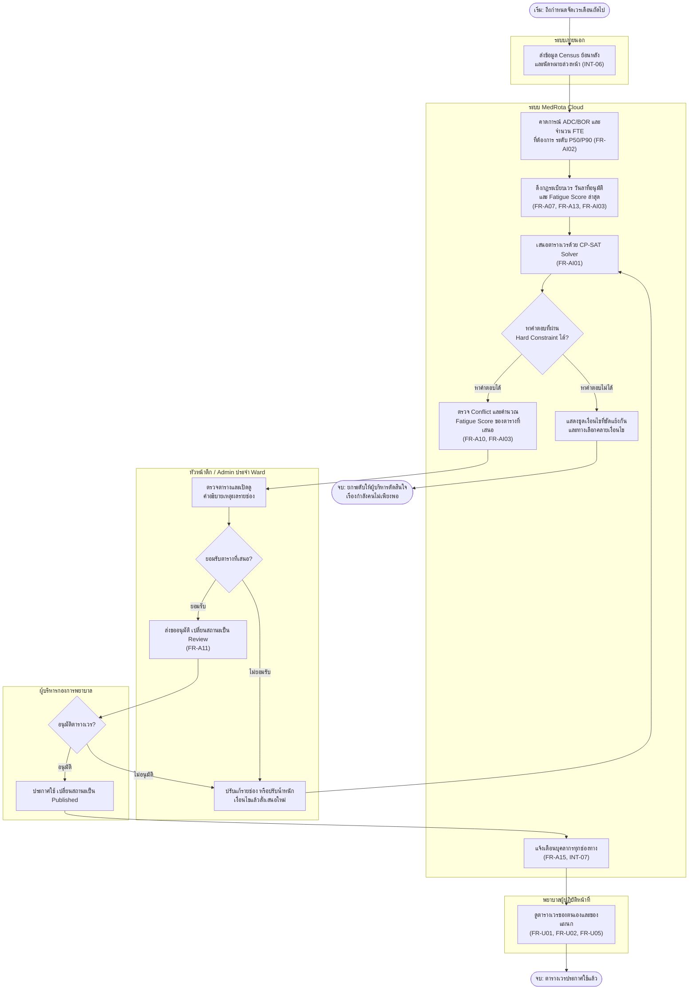
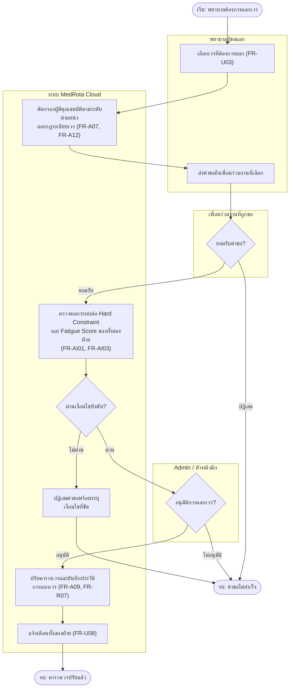
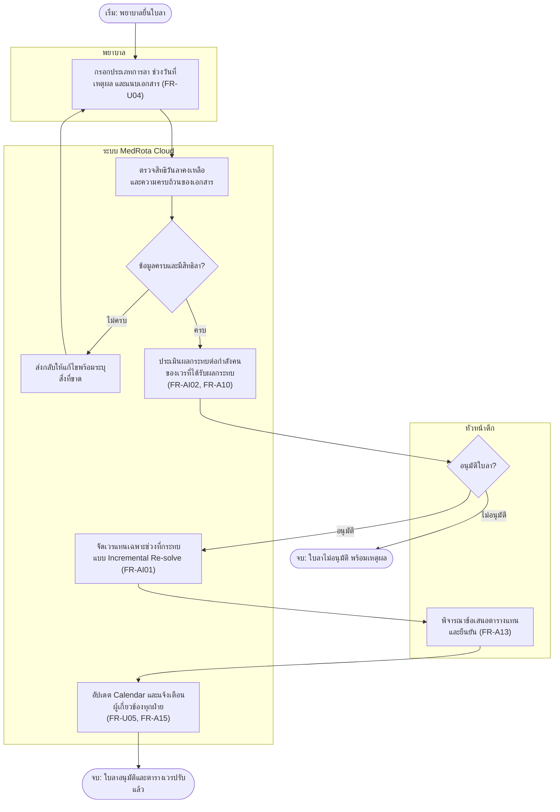
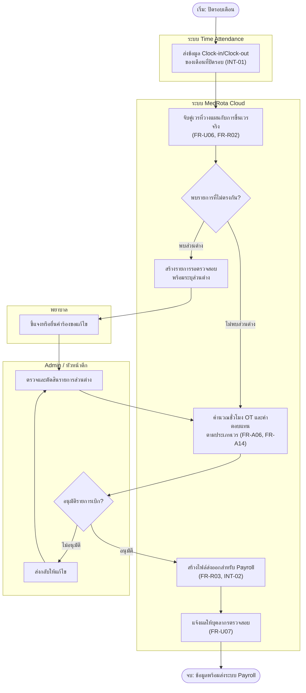
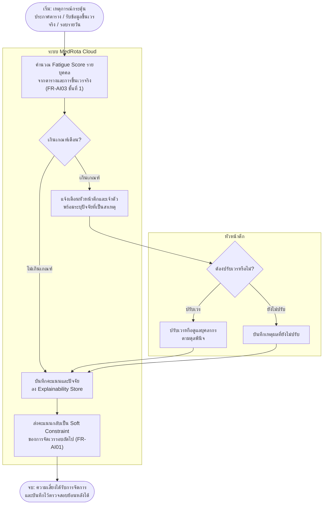
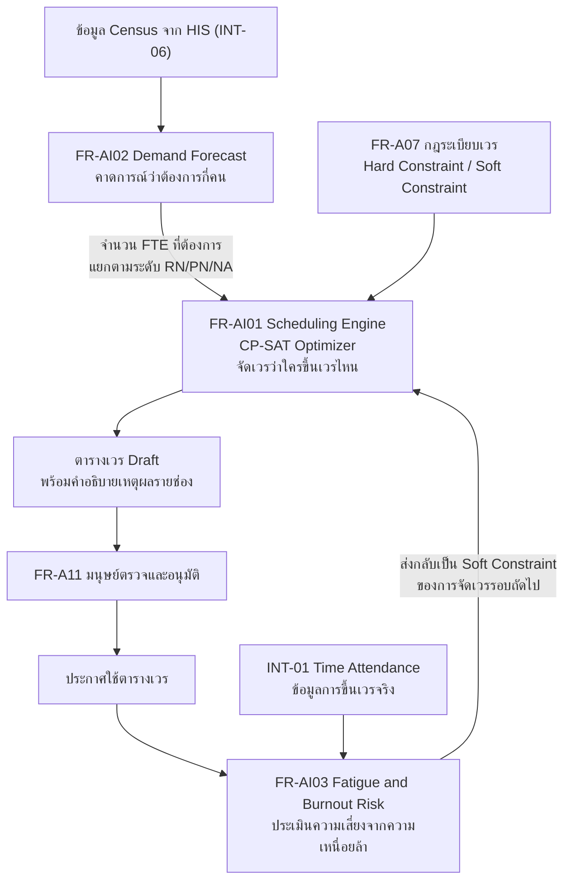

**PRODUCT REQUIREMENT DOCUMENT**

**บริหารจัดการเวรโรงพยาบาล**

MedRota Cloud

| รายการ | รายละเอียด |
|---|---|
| **เวอร์ชัน** | 1.0.0 |
| **สถานะ**         | Draft – รอการอนุมัติ                         |
| **วันที่จัดทำ**       | 7 พฤษภาคม 2568                            |
| **Project Owner** | \[กองการพยาบาล / ระบุชื่อผู้รับผิดชอบ\]          |
| **เอกสารจัดทำโดย** | Senior Product Manager & System Architect |
| **ระดับความลับ**    | ภายในองค์กร (Internal)                     |

> 📎 **เอกสารประกอบ** แผนปฏิบัติงานระดับ Sprint แยกอยู่ในไฟล์ `MVP_ExecutionPlan_v1.0.md`

# 1. Executive Summary

บริหารจัดการเวรโรงพยาบาล (MedRota Cloud) คือแพลตฟอร์มดิจิทัลสำหรับโรงพยาบาล ที่ออกแบบมาเพื่อแก้ไขปัญหาหลักในการบริหารกำลังคนทางการพยาบาล ได้แก่ ความไม่สอดคล้องระหว่างตารางเวรที่วางแผนไว้กับการขึ้นเวรจริง รวมถึงความผิดพลาดในกระบวนการเบิก-จ่ายค่าตอบแทนล่วงเวลา

ระบบประกอบด้วย 5 ความสามารถหลัก ได้แก่ (1) การวางแผนกำลังคนอัจฉริยะที่สอดคล้องกับ Supply ของบุคลากรและ Demand ของผู้ป่วย (2) การเชื่อมต่อกับระบบลงเวลางาน (Time Attendance) เพื่อตรวจสอบการขึ้นเวรจริง (3) ระบบอนุมัติการแลกเวรและการลาหยุด (4) การรายงานสถิติเชิงวิเคราะห์และคาดการณ์กำลังคนล่วงหน้า และ (5) ระบบเบิก-จ่ายค่าล่วงเวลาที่แม่นยำ อิงข้อมูลการขึ้นเวรจริง

ระบบรองรับการเข้าใช้งานผ่านเว็บเบราว์เซอร์และอุปกรณ์เคลื่อนที่ (Responsive Web) รองรับการ Login ผ่าน Gmail, Outlook และ Facebook พร้อม RESTful API สำหรับการเชื่อมต่อกับระบบภายนอก

จุดที่สร้างความแตกต่างจากระบบจัดเวรทั่วไปคือความสามารถด้าน AI 3 ฟังก์ชันที่ทำงานต่อเนื่องเป็นวงจรปิด (หัวข้อ 5.4) ได้แก่ **การคาดการณ์ความต้องการกำลังคนล่วงหน้า (FR-AI02)** ที่ทำให้การจัดเวรอ้างอิงภาระงานที่จะเกิดขึ้นจริงแทนการคัดลอกตารางเดือนก่อน, **เครื่องยนต์จัดเวรที่รับประกันว่าไม่ละเมิดกฎและอธิบายเหตุผลได้ทุกช่อง (FR-AI01)** ซึ่งลดเวลาจัดเวรจากหลายชั่วโมงเหลือไม่เกิน 5 นาที, และ **การประเมินความเสี่ยงจากความเหนื่อยล้า (FR-AI03)** ที่เชื่อมการบริหารเวรเข้ากับความปลอดภัยผู้ป่วยและการรักษาบุคลากรไว้ในองค์กร โดยทุกฟังก์ชันยึดหลักให้ AI เป็นผู้เสนอและมนุษย์เป็นผู้ตัดสินใจ

# 2. Goals & Objectives

## 2.1 วัตถุประสงค์เชิงธุรกิจ (Business Objectives)

| ID    | วัตถุประสงค์                | รายละเอียด                                                                            |
|-----------|------------------------------|------------------------------------------------------------------------------------------|
| **BO-01** | ระบบวางแผนกำลังคนที่น่าเชื่อถือ     | มีระบบกลางสำหรับวางแผนและจัดเวรบุคลากรพยาบาลทุก Ward แทนการใช้ Excel หรือกระดาษ                 |
| **BO-02** | วางแผนและคาดการณ์กำลังคนล่วงหน้า | สามารถวิเคราะห์แนวโน้มการใช้บริการและวางแผนกำลังคนล่วงหน้าได้อย่างน้อย 1 เดือน                       |
| **BO-03** | ระบบเบิก-จ่ายที่ถูกต้องแม่นยำ       | ลดความผิดพลาดในการคำนวณค่าล่วงเวลาโดยอิงข้อมูลจากการขึ้นเวรจริง ลดข้อโต้แย้งระหว่างบุคลากรและฝ่ายการเงิน |
| **BO-04** | บริหารจัดการอย่างเป็นธรรม        | สร้างระบบการจัดเวรที่โปร่งใส ยุติธรรม และตรวจสอบได้ ลดข้อร้องเรียนจากบุคลากร                         |

## 2.2 วัตถุประสงค์เชิงเทคนิค (Technical Objectives)

| ID    | วัตถุประสงค์                  | รายละเอียด                                                                |
|-----------|--------------------------------|------------------------------------------------------------------------------|
| **TO-01** | Integration กับ Time Attendance | เชื่อมต่อ API กับระบบลงเวลางาน (Time Attendance) เพื่อดึงข้อมูลการปฏิบัติงานจริงโดยอัตโนมัติ |
| **TO-02** | RESTful API                    | เปิด API สำหรับรองรับการเชื่อมต่อกับระบบภายนอก เช่น ระบบ HR, Payroll, HIS            |
| **TO-03** | SSO Authentication             | รองรับการ Login ผ่าน OAuth2.0: Gmail (Google), Outlook (Microsoft), Facebook   |
| **TO-04** | Responsive Design              | รองรับการใช้งานบน Desktop, Tablet และ Mobile ผ่าน Responsive Web Design         |

# 3. User Personas

| ID | Persona          | Role               | เป้าหมาย                                         | ฟังก์ชันหลักที่ใช้                                               | Platform                 |
|--------|----------------------|------------------------|-----------------------------------------------------|---------------------------------------------------------------|------------------------------|
| P-01   | Admin ประจำ Ward     | เจ้าหน้าที่ธุรการ/เสมียน     | จัดการข้อมูลตารางเวร ข้อมูลบุคลากร และจัดทำรายงาน          | สร้าง/แก้ไขตารางเวร, อนุมัติแลกเวร, ส่งออกรายงาน, จัดการ Master Data | Web Browser (Desktop เป็นหลัก) |
| P-02   | หัวหน้าตึก (Head Nurse) | หัวหน้าพยาบาลประจำ Ward  | ควบคุมกำลังคนให้เพียงพอ ติดตามการขึ้นเวร วิเคราะห์ภาระงาน    | ดูภาพรวม Dashboard, อนุมัติการแลกเวร/ลา, ดูรายงานวิเคราะห์           | Web + Mobile                 |
| P-03   | ผู้บริหารกองการพยาบาล   | ผู้อำนวยการ/รองผู้อำนวยการ | ติดตามภาพรวมกำลังคนทั้งกอง วิเคราะห์แนวโน้ม วางแผนเชิงกลยุทธ์ | ดู Executive Dashboard, รายงานเชิงวิเคราะห์, KPI Report           | Web Browser                  |
| P-04   | พยาบาลผู้ปฏิบัติหน้าที่      | พยาบาลวิชาชีพ/เจ้าหน้าที่    | ตรวจสอบเวรตัวเอง แจ้งแลกเวร แจ้งลา ดูประวัติการขึ้นเวร      | ดูตารางเวรส่วนตัว, ส่งคำขอแลกเวร, แจ้งลา, รับการแจ้งเตือน             | Mobile เป็นหลัก + Web          |

# 4. Business Process Design (BPMN)

หัวข้อนี้อธิบายกระบวนการทางธุรกิจที่ระบบต้องรองรับ ในมุมมองระดับกระบวนการ (Business Level) ซึ่งเป็นที่มาของข้อกำหนดฟังก์ชันในหัวข้อ 5 ส่วนลำดับการคลิกใช้งานระดับหน้าจอ (UI Level) อยู่ในหัวข้อ 7.3

## 4.1 สัญลักษณ์และข้อตกลงที่ใช้ในแผนผัง

แผนผังในเอกสารนี้เขียนด้วย Mermaid เพื่อให้แก้ไขและตรวจทานร่วมกันได้ในไฟล์เดียวกับเอกสาร โดยใช้สัญลักษณ์เทียบเคียงมาตรฐาน BPMN 2.0 ดังนี้ และในช่วง Sprint 0 จะแปลงเป็น BPMN 2.0 XML สำหรับเครื่องมือออกแบบกระบวนการต่อไป

| สัญลักษณ์ในแผนผัง | เทียบเคียง BPMN 2.0 | ความหมาย |
|---|---|---|
| กล่องปลายมน `( )` | Start / End Event | จุดเริ่มต้นและจุดสิ้นสุดของกระบวนการ |
| กล่องสี่เหลี่ยม | Task / Activity | กิจกรรมที่คนหรือระบบทำ |
| กล่องสี่เหลี่ยมขนมเปียกปูน | Exclusive Gateway (XOR) | จุดตัดสินใจที่เลือกเส้นทางเดียว |
| กรอบครอบกลุ่มกิจกรรม | Pool / Lane | ผู้รับผิดชอบกิจกรรมในกรอบนั้น |
| ข้อความกำกับเส้น | Sequence Flow Condition | เงื่อนไขของเส้นทางที่เลือก |

**ข้อตกลงการตั้งรหัส** กระบวนการใช้รหัส BP-xx และทุกกิจกรรมอ้างอิงรหัส FR ที่รองรับ เพื่อให้ทำ Traceability Matrix ระหว่างกระบวนการและข้อกำหนดฟังก์ชันได้

## 4.2 ภาพรวมกระบวนการหลัก (Process Landscape)

| BP ID | กระบวนการ | ตัวกระตุ้น (Trigger) | เจ้าของกระบวนการ | ความถี่ | FR ที่รองรับ |
|---|---|---|---|---|---|
| **BP-01** | วางแผนและประกาศตารางเวรประจำเดือน | ถึงกำหนดจัดเวรของเดือนถัดไป | หัวหน้าตึก | รายเดือน | FR-A06 ถึง FR-A11, FR-AI01, FR-AI02, FR-U01, FR-U02, FR-U05 |
| **BP-02** | ยื่นและอนุมัติการแลกเวร | พยาบาลต้องการแลกเวร | หัวหน้าตึก | ตามเหตุการณ์ | FR-U03, FR-A12, FR-R07 |
| **BP-03** | ยื่นและอนุมัติการลาหยุด | พยาบาลยื่นใบลา | หัวหน้าตึก | ตามเหตุการณ์ | FR-U04, FR-A13, FR-AI01, FR-R08 |
| **BP-04** | เบิก-จ่ายค่าล่วงเวลา | ปิดรอบเดือน | ฝ่ายการเงิน / Admin | รายเดือน | FR-A14, FR-U06, FR-U07, FR-R02, FR-R03, INT-01, INT-02 |
| **BP-05** | เฝ้าระวังความเหนื่อยล้าของบุคลากร | ประกาศตาราง / รับข้อมูลขึ้นเวรจริง / รอบรายวัน | หัวหน้าตึก | รายวันและตามเหตุการณ์ | FR-AI03, FR-R04, FR-AI01 |

## 4.3 BP-01 วางแผนและประกาศตารางเวรประจำเดือน

กระบวนการนี้เป็นหัวใจของระบบ และเป็นจุดที่ความสามารถด้าน AI ทั้งสามฟังก์ชันทำงานร่วมกัน

| หัวข้อ | รายละเอียด |
|---|---|
| **Trigger** | ถึงกำหนดจัดเวรของเดือนถัดไป (แนะนำเริ่มล่วงหน้า 21 วันก่อนต้นเดือน) |
| **Actor / Lane** | ระบบภายนอก (HIS), ระบบ MedRota Cloud, หัวหน้าตึกและ Admin ประจำ Ward, ผู้บริหารกองการพยาบาล, พยาบาลผู้ปฏิบัติหน้าที่ |
| **Input** | ข้อมูล Census ย้อนหลังและนัดหมายล่วงหน้า, ข้อมูลบุคลากร, กฎระเบียบเวร, วันลาที่อนุมัติแล้ว, Fatigue Score ล่าสุด |
| **Output** | ตารางเวรสถานะ Published พร้อมคำอธิบายเหตุผลรายช่อง และการแจ้งเตือนถึงบุคลากรทุกคน |
| **SLA ที่เสนอ** | ประกาศตารางเวรให้บุคลากรทราบล่วงหน้าไม่น้อยกว่า 14 วันก่อนเริ่มเดือน |

**ตารางขั้นตอนและการจัดการข้อยกเว้น**

| ลำดับ | Lane | กิจกรรม | ประเภท | กฎธุรกิจ / ข้อยกเว้น |
|---|---|---|---|---|
| 1 | ระบบภายนอก | รับข้อมูล Census และนัดหมายล่วงหน้า | Service Task | หาก HIS ไม่ตอบสนอง ให้ใช้ค่าเฉลี่ยย้อนหลัง 4 สัปดาห์แทน และแสดงป้ายกำกับว่าเป็นค่าสำรอง |
| 2 | ระบบ | คาดการณ์กำลังคนที่ต้องการ | Service Task | ผู้บริหารเลือกระดับ P50 หรือ P90 ต่อ Ward ไว้ล่วงหน้า (ดู FR-AI02) |
| 3 | ระบบ | ดึงกฎระเบียบและข้อมูลประกอบ | Service Task | วันลาที่อนุมัติแล้วถือเป็น Hard Constraint ห้ามมอบหมายเวรทับ |
| 4 | ระบบ | เสนอตารางเวร | Service Task | ทำงานแบบ Asynchronous Job; หากเกินกรอบเวลาที่ตั้งไว้ ให้คืนคำตอบที่ดีที่สุดที่พบพร้อมระบุว่ายังไม่ใช่คำตอบที่ดีที่สุด |
| 5 | ระบบ | ตรวจ Conflict และคำนวณ Fatigue Score | Service Task | หากพบผู้มีคะแนนเกินเกณฑ์เตือน ให้แสดงธงเตือนในตารางก่อนส่งให้ตรวจ |
| 6 | หัวหน้าตึก | ตรวจตารางและดูคำอธิบายเหตุผล | User Task | ทุกช่องต้องเปิดดูเหตุผลได้ตาม AIP-01 |
| 7 | หัวหน้าตึก | ปรับแก้หรือสั่งเสนอใหม่ | User Task | การแก้มือทุกครั้งต้องผ่านการตรวจ Hard Constraint ซ้ำ และบันทึก Change Log (FR-A09) |
| 8 | ผู้บริหาร | อนุมัติตารางเวร | User Task | ไม่มีการ Publish อัตโนมัติตาม AIP-02 |
| 9 | ระบบ | แจ้งเตือนบุคลากร | Service Task | หากช่องทาง SMS ล้มเหลว ให้ส่งซ้ำผ่าน In-app และ Email แล้วบันทึกผลการส่ง |
| **EX-1** | ระบบ | กรณีหาคำตอบไม่ได้ (Infeasible) | Exception | ต้องระบุชุดเงื่อนไขที่ขัดแย้งกันอย่างชัดเจน พร้อมเสนอทางเลือก เช่น ยืมกำลังคนจาก Ward อื่น หรือขออนุมัติผ่อนผันเกณฑ์เฉพาะกรณี ห้ามแจ้งเพียงว่าจัดเวรไม่ได้ |
| **EX-2** | หัวหน้าตึก | วนแก้ไขเกิน 3 รอบ | Exception | ให้ระบบเสนอให้ทบทวนน้ำหนักเงื่อนไขหรือเกณฑ์กำลังคนขั้นต่ำ แทนการแก้ตารางรายช่องต่อไป |

## 4.4 BP-02 ยื่นและอนุมัติการแลกเวร

| หัวข้อ | รายละเอียด |
|---|---|
| **Trigger** | พยาบาลต้องการแลกเวรกับเพื่อนร่วมงาน |
| **Actor / Lane** | พยาบาลผู้ขอแลก, เพื่อนร่วมงานที่ถูกขอ, ระบบ MedRota Cloud, Admin หรือหัวหน้าตึก |
| **Input** | เวรที่ต้องการแลก, คุณสมบัติของบุคลากรทั้งสองฝ่าย, กฎระเบียบเวร |
| **Output** | ตารางเวรที่ปรับแล้ว พร้อมประวัติการแลกเวรที่ตรวจสอบย้อนหลังได้ |
| **SLA ที่เสนอ** | ตัดสินคำขอภายใน 24 ชั่วโมงสำหรับเวรที่ห่างจากวันนี้เกิน 3 วัน และภายใน 4 ชั่วโมงสำหรับเวรที่ใกล้กว่านั้น |

**ตารางขั้นตอนและการจัดการข้อยกเว้น**

| ลำดับ | Lane | กิจกรรม | ประเภท | กฎธุรกิจ / ข้อยกเว้น |
|---|---|---|---|---|
| 1 | พยาบาล | เลือกเวรที่ต้องการแลก | User Task | แลกได้เฉพาะเวรที่ยังไม่เริ่มและอยู่ในตารางที่ประกาศใช้แล้ว |
| 2 | ระบบ | คัดกรองผู้มีคุณสมบัติ | Service Task | ระบบแสดงเฉพาะผู้ที่แลกได้จริง เพื่อไม่ให้เกิดคำขอที่ถูกปฏิเสธภายหลังโดยไม่จำเป็น |
| 3 | เพื่อนร่วมงาน | ตอบรับหรือปฏิเสธ | User Task | หากไม่ตอบภายในกรอบเวลา SLA ให้ถือว่าปฏิเสธและแจ้งผู้ขอทราบ |
| 4 | ระบบ | ตรวจผลกระทบต่อเงื่อนไขบังคับ | Service Task | ต้องตรวจทั้งสองฝ่าย เพราะการแลกอาจทำให้ฝ่ายใดฝ่ายหนึ่งพักไม่ถึงเกณฑ์ขั้นต่ำ |
| 5 | Admin | อนุมัติ | User Task | การอนุมัติต้องบันทึกผู้อนุมัติและเวลาเพื่อการตรวจสอบ |
| **EX-1** | ระบบ | ผลตรวจไม่ผ่าน | Exception | ต้องระบุเงื่อนไขที่ขัดให้ผู้ขอทราบ และเสนอรายชื่อผู้อื่นที่แลกได้แทน |
| **EX-2** | ทุก Lane | เวรเริ่มแล้วระหว่างรอการตัดสิน | Exception | ยกเลิกคำขออัตโนมัติและแจ้งทุกฝ่ายทราบ |

## 4.5 BP-03 ยื่นและอนุมัติการลาหยุด

จุดสำคัญของกระบวนการนี้คือ เมื่ออนุมัติใบลา ระบบจัดเวรแทนเฉพาะช่วงที่ได้รับผลกระทบ (Incremental Re-solve) เพื่อไม่ให้บุคลากรทั้ง Ward ต้องปรับแผนใหม่ทั้งหมด

| หัวข้อ | รายละเอียด |
|---|---|
| **Trigger** | พยาบาลยื่นใบลาผ่านระบบ |
| **Actor / Lane** | พยาบาล, ระบบ MedRota Cloud, หัวหน้าตึก |
| **Input** | ประเภทการลา, ช่วงวันที่ลา, เหตุผล, เอกสารแนบ, สิทธิวันลาคงเหลือ |
| **Output** | ใบลาที่ได้รับการตัดสิน และตารางเวรที่ปรับแทนแล้ว |
| **SLA ที่เสนอ** | ลาล่วงหน้าตัดสินภายใน 2 วันทำการ; ลาป่วยฉุกเฉินตัดสินภายใน 2 ชั่วโมง |

**ตารางขั้นตอนและการจัดการข้อยกเว้น**

| ลำดับ | Lane | กิจกรรม | ประเภท | กฎธุรกิจ / ข้อยกเว้น |
|---|---|---|---|---|
| 1 | พยาบาล | ยื่นใบลา | User Task | ลาป่วยย้อนหลังยื่นได้ภายในกรอบเวลาที่ระเบียบกำหนด \[ระบุตามระเบียบของโรงพยาบาล\] |
| 2 | ระบบ | ตรวจสิทธิและเอกสาร | Business Rule Task | ลาป่วยเกินจำนวนวันที่กำหนดต้องแนบใบรับรองแพทย์ |
| 3 | ระบบ | ประเมินผลกระทบต่อกำลังคน | Service Task | แสดงให้หัวหน้าตึกเห็นว่าหากอนุมัติแล้วเวรใดจะขาดกำลังคน และมีผู้ใดที่รับแทนได้ |
| 4 | หัวหน้าตึก | ตัดสินใบลา | User Task | การไม่อนุมัติต้องระบุเหตุผลเป็นลายลักษณ์อักษรทุกครั้ง |
| 5 | ระบบ | จัดเวรแทนเฉพาะช่วงที่กระทบ | Service Task | ต้องคงตารางส่วนที่ไม่เกี่ยวข้องไว้ให้มากที่สุด และแสดงรายชื่อผู้ที่ถูกเปลี่ยนเวรให้หัวหน้าตึกยืนยัน |
| **EX-1** | ระบบ | ไม่มีผู้ที่รับเวรแทนได้ | Exception | เสนอทางเลือกเรียงตามผลกระทบน้อยไปมาก เช่น ยืมกำลังคนจาก Ward อื่น, เปิดเวรพิเศษ, หรือขอผ่อนผันเกณฑ์กำลังคนขั้นต่ำเฉพาะเวรนั้น |
| **EX-2** | พยาบาล | ลาป่วยฉุกเฉินในวันที่มีเวร | Exception | เข้าเส้นทางเร่งด่วน แจ้งหัวหน้าตึกทันทีผ่านการแจ้งเตือนภายในระบบและ SMS และระบบเสนอผู้รับแทนภายใน 15 นาที |

## 4.6 BP-04 เบิก-จ่ายค่าล่วงเวลา

กระบวนการนี้ตอบวัตถุประสงค์ BO-03 โดยตรง เพราะคำนวณค่าล่วงเวลาจากข้อมูลการขึ้นเวรจริง ไม่ใช่จากตารางที่วางแผนไว้

| หัวข้อ | รายละเอียด |
|---|---|
| **Trigger** | ปิดรอบเดือน (วันที่ \[ระบุตามรอบของฝ่ายการเงิน\]) |
| **Actor / Lane** | ระบบ Time Attendance, ระบบ MedRota Cloud, พยาบาล, Admin และหัวหน้าตึก |
| **Input** | ข้อมูล Clock-in/Clock-out จริง, ตารางเวรที่ประกาศใช้, อัตราค่าตอบแทนตามประเภทเวร |
| **Output** | รายการเบิกค่าล่วงเวลาที่อนุมัติแล้ว และไฟล์ส่งออกสำหรับระบบ Payroll |
| **SLA ที่เสนอ** | ส่งข้อมูลให้ฝ่ายการเงินภายใน 5 วันทำการหลังปิดรอบเดือน |

**ตารางขั้นตอนและการจัดการข้อยกเว้น**

| ลำดับ | Lane | กิจกรรม | ประเภท | กฎธุรกิจ / ข้อยกเว้น |
|---|---|---|---|---|
| 1 | Time Attendance | ส่งข้อมูลการลงเวลา | Service Task | หากไม่รองรับ API ให้ใช้เส้นทางสำรองนำเข้าไฟล์ CSV หรือ Excel ตาม RK-03 |
| 2 | ระบบ | จับคู่แผนกับผลจริง | Service Task | กรณีลงเวลาไม่ครบคู่ หรือลงเวลาข้ามเที่ยงคืน ต้องมีกฎการตีความที่ตกลงกับฝ่ายบุคคลไว้ล่วงหน้า |
| 3 | พยาบาล | ชี้แจงส่วนต่าง | User Task | เปิดให้ชี้แจงได้ภายในกรอบเวลาที่กำหนด หากไม่ชี้แจงให้ใช้ข้อมูลจากเครื่องลงเวลาเป็นหลัก |
| 4 | Admin | ตัดสินรายการส่วนต่าง | User Task | ทุกการปรับแก้ตัวเลขต้องมีเหตุผลและผู้อนุมัติกำกับไว้ใน Audit Log ตาม NFR-03 |
| 5 | ระบบ | คำนวณและส่งออก | Service Task | ไฟล์ส่งออกต้องตรงตามรูปแบบที่ระบบ Payroll กำหนด \[ระบุรูปแบบตามระบบที่ใช้\] |
| **EX-1** | ระบบ | ข้อมูลลงเวลาหายหรือไม่สมบูรณ์ | Exception | กันรายการนั้นออกจากการคำนวณและแจ้งให้ Admin จัดการรายกรณี ห้ามประมาณค่าแทนโดยอัตโนมัติ |
| **EX-2** | Admin | ส่งข้อมูลให้ Payroll แล้วพบข้อผิดพลาด | Exception | ออกรายการปรับปรุงในรอบถัดไป โดยอ้างอิงรอบเดิมและเหตุผล ไม่แก้ย้อนหลังในรอบที่ปิดแล้ว |

## 4.7 BP-05 เฝ้าระวังความเหนื่อยล้าของบุคลากร

กระบวนการนี้ทำงานแบบอัตโนมัติตามเหตุการณ์ และเป็นจุดที่ปิดวงจรการทำงานของ AI โดยส่งผลลัพธ์กลับไปเป็นเงื่อนไขของการจัดเวรรอบถัดไป

| หัวข้อ | รายละเอียด |
|---|---|
| **Trigger** | มีการประกาศใช้ตารางเวร หรือรับข้อมูลการขึ้นเวรจริงเข้าระบบ หรือรอบประมวลผลรายวัน |
| **Actor / Lane** | ระบบ MedRota Cloud, หัวหน้าตึก |
| **Input** | ตารางเวรที่ประกาศใช้, ข้อมูลการขึ้นเวรจริง, ค่าน้ำหนักปัจจัยและเกณฑ์เตือนที่ตั้งไว้ |
| **Output** | Fatigue Score รายบุคคลพร้อมปัจจัยประกอบ, การแจ้งเตือนผู้เกี่ยวข้อง, Soft Constraint สำหรับการจัดเวรรอบถัดไป |
| **SLA ที่เสนอ** | คำนวณและแจ้งเตือนเสร็จภายใน 15 นาทีหลังเกิดเหตุการณ์กระตุ้น |

**ตารางขั้นตอนและการจัดการข้อยกเว้น**

| ลำดับ | Lane | กิจกรรม | ประเภท | กฎธุรกิจ / ข้อยกเว้น |
|---|---|---|---|---|
| 1 | ระบบ | คำนวณ Fatigue Score | Service Task | ใช้สูตรถ่วงน้ำหนักตามเกณฑ์ที่สอบเทียบไว้ใน Sprint 0 (ดู FR-AI03) |
| 2 | ระบบ | ตัดสินว่าเกินเกณฑ์เตือนหรือไม่ | Business Rule Task | เกณฑ์เตือนตั้งค่าแยกตามประเภทหอผู้ป่วยได้ |
| 3 | ระบบ | แจ้งเตือนผู้เกี่ยวข้อง | Service Task | แจ้งเฉพาะเจ้าตัวและหัวหน้าตึกที่รับผิดชอบ ระดับผู้บริหารเห็นเฉพาะข้อมูลรวมระดับแผนก ตามมาตรการใน FR-AI03 |
| 4 | หัวหน้าตึก | ตัดสินใจดำเนินการ | User Task | ระบบเป็นผู้แจ้งเตือน มนุษย์เป็นผู้ตัดสินตาม AIP-02; การเลือกไม่ปรับต้องบันทึกเหตุผล |
| 5 | ระบบ | ส่งคะแนนกลับเป็น Soft Constraint | Service Task | ทำให้การจัดเวรรอบถัดไปหลีกเลี่ยงรูปแบบที่ผลักคะแนนของผู้ใดเกินเกณฑ์ |
| **EX-1** | ระบบ | ข้อมูลการขึ้นเวรจริงมาไม่ครบ | Exception | คำนวณจากตารางที่ประกาศใช้แทน และกำกับไว้ว่าเป็นค่าประมาณจากแผน ไม่ใช่จากผลจริง |
| **EX-2** | หัวหน้าตึก | พบผู้มีคะแนนเกินเกณฑ์หลายรายในเวลาเดียวกัน | Exception | ยกระดับให้ผู้บริหารกองการพยาบาลทราบ เพราะเป็นสัญญาณว่ากำลังคนของ Ward ไม่เพียงพอในเชิงโครงสร้าง ไม่ใช่ปัญหารายบุคคล |

# 5. Functional Requirements

ข้อกำหนดฟังก์ชันการทำงานแบ่งออกเป็น 4 กลุ่มหลัก ได้แก่ Admin Features, User Features, Reports และ AI Capabilities โดยแต่ละรายการได้รับ ID เพื่อรองรับการทำ Traceability Matrix

## 5.1 Admin Features

### 5.1.1 Master Data Management

| FR ID  | ฟังก์ชัน                           | รายละเอียด                                                                                              | Priority |
|------------|-------------------------------------|------------------------------------------------------------------------------------------------------------|--------------|
| **FR-A01** | จัดการผู้ใช้งาน (User Management)       | เพิ่ม/แก้ไข/ลบ/ระงับบัญชีผู้ใช้, กำหนดรหัสประจำตัว, บทบาท, แผนก, ระดับตำแหน่ง และสิทธิ์การเข้าถึง                            | Must Have    |
| **FR-A02** | จัดการสิทธิ์ (Authorization)            | กำหนด Role-Based Access Control (RBAC): SuperAdmin, WardAdmin, HeadNurse, Nurse; กำหนดสิทธิ์รายเมนู            | Must Have    |
| **FR-A03** | จัดการเมนู (Menu Management)          | เปิด/ปิด เมนูการใช้งานตาม Role และสิทธิ์; Dynamic Menu Configuration                                              | Should Have  |
| **FR-A04** | จัดการข้อมูล Ward/แผนก                 | เพิ่ม/แก้ไข/ลบข้อมูล Ward, Department, อาคาร, ประเภทหอผู้ป่วย (ICU, General, ER ฯลฯ)                               | Must Have    |
| **FR-A05** | จัดการข้อมูลโรงพยาบาล                  | ตั้งค่าข้อมูลสถาบัน: ชื่อ ที่อยู่ โลโก้ นโยบายการขึ้นเวร เช่น ชั่วโมงขั้นต่ำ/สูงสุดต่อเดือน กฎการพักผ่อน                              | Must Have    |
| **FR-A06** | จัดการประเภทเวร (Shift Type)         | กำหนดประเภทเวร เช่น เช้า (08:00-16:00), บ่าย (16:00-00:00), ดึก (00:00-08:00), เวรพิเศษ พร้อมระบุค่าตอบแทน         | Must Have    |
| **FR-A07** | จัดการกฎระเบียบเวร (Scheduling Rules) | กำหนดกฎ เช่น ห้ามขึ้นเวรติดต่อกัน X วัน, พักระหว่างเวร Y ชั่วโมง, จำนวนเวรดึกต่อเดือนไม่เกิน Z เวร, Workload ต่อ Nurse Ratio | Must Have    |

### 5.1.2 Schedule Management

| FR ID  | ฟังก์ชัน                            | รายละเอียด                                                                                                  | Priority |
|------------|--------------------------------------|----------------------------------------------------------------------------------------------------------------|--------------|
| **FR-A08** | สร้างตารางเวรประจำเดือน                | หน้าจอและ Workflow สำหรับสร้างตารางเวรรายเดือนของ Ward รองรับทั้ง Manual Input และปุ่ม Auto-suggest ซึ่งเรียกใช้เครื่องยนต์ AI ตาม **FR-AI01**   | Must Have    |
| **FR-A09** | แก้ไขตารางเวร                         | แก้ไขตารางเวรที่ยังไม่ได้ประกาศใช้; บันทึก Change Log ทุกการแก้ไข พร้อมผู้แก้ไขและเวลา                                        | Must Have    |
| **FR-A10** | ตรวจสอบความขัดแย้งเวร (Conflict Check) | แจ้งเตือนอัตโนมัติเมื่อตารางเวรที่สร้างขัดแย้งกับกฎระเบียบ เช่น พักไม่ครบ ขึ้นเวรซ้ำ หรือบุคลากรไม่เพียงพอต่อ Nurse-to-Patient Ratio    | Must Have    |
| **FR-A11** | อนุมัติ/ประกาศตารางเวร                  | ขั้นตอน Workflow การอนุมัติตารางเวร: Draft → Review → Approved → Published; แจ้งเตือนบุคลากรเมื่อตารางประกาศ             | Must Have    |
| **FR-A12** | อนุมัติการแลกเวร                        | ตรวจสอบคุณสมบัติของผู้แลกเวร (ระดับตำแหน่ง, ความสามารถ) ก่อนอนุมัติ; บันทึกประวัติการแลกเวรทุกครั้ง                              | Must Have    |
| **FR-A13** | อนุมัติใบลา                             | รับและอนุมัติ/ปฏิเสธใบลาของบุคลากร พร้อมเหตุผล; อัปเดตตารางเวรโดยอัตโนมัติ; แจ้งเตือนผ่านช่องทางตาม FR-U08                      | Must Have    |
| **FR-A14** | อนุมัติการเบิกค่าล่วงเวลา                  | ตรวจสอบและอนุมัติรายการเบิกค่าล่วงเวลา อิงข้อมูลการขึ้นเวรจริงจาก Time Attendance; ส่งออกข้อมูลสู่ระบบ Payroll                  | Must Have    |
| **FR-A15** | ระบบแจ้งเตือน (Notification)           | ส่ง Notification ผ่าน In-app, Email และ SMS \[ระบุ SMS Gateway ที่ใช้\] สำหรับ: ตารางเวรใหม่, การอนุมัติ, การเปลี่ยนแปลงเวร | Should Have  |

## 5.2 User Features (พยาบาลผู้ปฏิบัติหน้าที่)

| FR ID  | ฟังก์ชัน                | รายละเอียด                                                                                                               | Priority |
|------------|--------------------------|-----------------------------------------------------------------------------------------------------------------------------|--------------|
| **FR-U01** | ดูตารางเวรประจำเดือน       | แสดงตารางเวรของแผนกที่สังกัดในรูปแบบ Monthly Calendar และ List View; กรองตามบุคลากรหรือประเภทเวร                                   | Must Have    |
| **FR-U02** | ดูตารางเวรส่วนตัว           | แสดงเฉพาะเวรของตัวเอง พร้อมสรุปชั่วโมงการทำงาน จำนวนเวรในเดือน และค่าล่วงเวลาโดยประมาณ                                              | Must Have    |
| **FR-U03** | ยื่นคำขอแลกเวร             | เลือกเวรที่ต้องการแลก ค้นหาเพื่อนร่วมงานที่ตรงคุณสมบัติ ส่งคำขอแลกเวร รอการอนุมัติจาก Admin; รับการแจ้งเตือนสถานะ                               | Must Have    |
| **FR-U04** | แจ้งลาหยุด (Leave Request) | ยื่นใบลาออนไลน์: ระบุประเภทการลา (ลาป่วย ลาพักร้อน ลากิจ), วันที่ลา, เหตุผล และเอกสารแนบ (ถ้ามี); ติดตามสถานะใบลา                          | Must Have    |
| **FR-U05** | ดู Calendar การขึ้นเวร      | แสดง Personal Calendar แสดงเวร วันลา วันหยุด และกิจกรรมสำคัญของแผนก; Sync กับ Google Calendar / Outlook Calendar \[ระบุหากต้องการ\] | Must Have    |
| **FR-U06** | ดูประวัติการขึ้นเวร           | แสดงประวัติการขึ้นเวรย้อนหลัง พร้อมเปรียบเทียบเวรที่วางแผนไว้กับการขึ้นเวรจริงจาก Time Attendance                                           | Should Have  |
| **FR-U07** | ดูสรุปค่าล่วงเวลาส่วนตัว       | แสดงสรุปการเบิกค่าล่วงเวลาของตัวเอง รายเดือน พร้อมสถานะการอนุมัติ                                                                     | Should Have  |
| **FR-U08** | รับการแจ้งเตือน             | รับการแจ้งเตือน (ภายในระบบ, SMS, อีเมล และ Web Push เป็นช่องเสริมตามที่อุปกรณ์รองรับ) เมื่อตารางเวรถูกเผยแพร่, คำขอแลกเวรได้รับการตอบรับ, ใบลาได้รับการอนุมัติ                                           | Must Have    |

## 5.3 Report Features

| FR ID  | รายงาน                                  | รายละเอียด                                                                                                       | Priority |
|------------|---------------------------------------------|---------------------------------------------------------------------------------------------------------------------|--------------|
| **FR-R01** | สรุปตารางเวรประจำเดือน                        | รายงานตารางเวรรายเดือน แยกรายบุคคลและรายแผนก รองรับการพิมพ์และส่งออก PDF/Excel                                            | Must Have    |
| **FR-R02** | รายงานกำลังคนประจำเดือน                       | สรุปจำนวนบุคลากรที่ขึ้นเวรจริง แยกตามระดับตำแหน่ง (RN, PN, NA) ต่อเดือน เทียบกับแผนที่วางไว้; แสดงค่า Variance                       | Must Have    |
| **FR-R03** | รายงานเบิก-จ่ายค่าล่วงเวลา                      | สรุปชั่วโมง OT และค่าล่วงเวลาของบุคลากร รายบุคคลและรายแผนก ประจำเดือน อิงข้อมูลจาก Time Attendance; ส่งออก Excel สำหรับ Payroll  | Must Have    |
| **FR-R04** | รายงานวิเคราะห์ความเหนื่อยล้า (Fatigue Analysis) | วิเคราะห์ชั่วโมงทำงานสะสม จำนวนเวรดึกติดต่อกัน และเวลาพักระหว่างเวรของบุคลากรแต่ละราย; แจ้งเตือนเมื่อพบความเสี่ยง; รายละเอียดแบบจำลองและมาตรการกำกับดูแลตาม **FR-AI03**                     | Should Have  |
| **FR-R05** | รายงานคาดการณ์กำลังคน (Forecast)              | คาดการณ์กำลังคนที่ต้องการในเดือนถัดไป โดยอิงข้อมูลจำนวนผู้ป่วย (ADC/BOR) และประวัติการขึ้นเวร; รายละเอียดแบบจำลองตาม **FR-AI02**                                        | Should Have  |
| **FR-R06** | Dashboard ภาพรวมผู้บริหาร                      | Executive Dashboard แสดง KPI หลัก: Nurse-to-Patient Ratio, OT Cost, Absenteeism Rate, Turnover Rate รายแผนกและรายกอง | Must Have    |
| **FR-R07** | รายงานประวัติการแลกเวร                        | สรุปจำนวนและรายละเอียดการแลกเวรประจำเดือน แยกรายบุคคลและรายแผนก                                                         | Could Have   |
| **FR-R08** | รายงานวิเคราะห์การลาหยุด                       | วิเคราะห์รูปแบบการลาของบุคลากร: อัตราการลา ประเภทการลา ช่วงเวลาที่ลามากที่สุด แนวโน้มรายปี                                       | Could Have   |

> 📌 Priority Legend: Must Have = ต้องมีภายใน MVP 2 | Should Have = ต้องมีภายใน MVP 5 | Could Have = พิจารณาในระยะขยายผล (ชุดส่งมอบที่รับผิดชอบแต่ละรายการระบุไว้ในเอกสาร MVP_ExecutionPlan_v1.0.md หัวข้อ 13)

## 5.4 AI Capabilities (ความสามารถด้าน AI — จุดขายหลักของระบบ)

ความสามารถด้าน AI ของ MedRota Cloud ประกอบด้วย 3 ฟังก์ชันที่ทำงานต่อเนื่องเป็นวงจรปิด (Closed Loop) ได้แก่ **การคาดการณ์ความต้องการกำลังคน (FR-AI02)** → **การจัดเวรอัจฉริยะ (FR-AI01)** → **การประเมินความเสี่ยงจากความเหนื่อยล้า (FR-AI03)** ซึ่งผลลัพธ์ย้อนกลับไปเป็นเงื่อนไขของการจัดเวรรอบถัดไป

### 5.4.1 หลักการออกแบบ AI (AI Design Principles)

| ID | หลักการ | สาระสำคัญ |
|---|---|---|
| **AIP-01** | Explainable by Design | ทุกคำแนะนำของระบบต้องอธิบายเหตุผลได้เป็นภาษาที่ผู้ใช้เข้าใจ ไม่ใช่กล่องดำ (Black Box); กรณีจัดเวรไม่สำเร็จ ระบบต้องระบุเงื่อนไขที่ขัดแย้งกันให้ชัดเจน |
| **AIP-02** | Human-in-the-Loop | AI ทำหน้าที่ "เสนอ" เท่านั้น การอนุมัติและประกาศใช้ตารางเวรต้องผ่านการตัดสินใจของมนุษย์ทุกครั้ง (ตาม FR-A11); ไม่มีการ Publish อัตโนมัติ |
| **AIP-03** | Guarantee over Guess | เงื่อนไขที่ห้ามละเมิด (Hard Constraint) เช่น เวลาพักขั้นต่ำ และ Nurse-to-Patient Ratio ต้องใช้วิธี Constraint Solver ที่รับประกันผลทางคณิตศาสตร์ ไม่ใช้โมเดลทำนายที่อาจคลาดเคลื่อน |
| **AIP-04** | Right Tool for the Problem | เลือกเทคนิคตามลักษณะของปัญหาและขนาดข้อมูล ไม่ใช้ Deep Learning หรือ LLM กับงานที่วิธีอื่นให้ผลแม่นยำกว่าและอธิบายได้ดีกว่า |
| **AIP-05** | Privacy-First | ข้อมูลบุคลากรต้องประมวลผลภายในขอบเขตระบบของโรงพยาบาล ไม่ส่งออกไปฝึกโมเดลของผู้ให้บริการภายนอก; สอดคล้องกับ PDPA และ NFR-03 |

### 5.4.2 แผนภาพการทำงานร่วมกัน (AI Pipeline)

### 5.4.3 FR-AI01 — Intelligent Shift Scheduling Engine (เครื่องยนต์จัดเวรอัจฉริยะ)

| หัวข้อ | รายละเอียด |
|---|---|
| **FR ID** | FR-AI01 |
| **ชื่อฟังก์ชัน** | เครื่องยนต์จัดเวรอัจฉริยะ พร้อมคำอธิบายเหตุผล |
| **Priority** | Must Have |
| **ชุดส่งมอบ** | MVP 2 (Hard Constraint + Fairness + ชั้นอธิบายเหตุผล) → ระยะขยายผล (Soft Constraint ครบถ้วน + เรียนรู้ความต้องการส่วนตัว) |
| **ความสัมพันธ์** | เป็นเครื่องยนต์เบื้องหลังปุ่ม Auto-suggest ของ FR-A08; ใช้กฎจาก FR-A07; ส่งผลให้ FR-A10 ตรวจไม่พบ Conflict |

**แนวคิด AI ที่ใช้: Constraint Programming + Multi-Objective Optimization**

ปัญหาการจัดเวรพยาบาล (Nurse Rostering Problem) เป็นปัญหาระดับ NP-hard ที่มีเงื่อนไขบังคับจำนวนมาก ระบบจึงเลือกใช้ **CP-SAT Solver** (Constraint Programming – Satisfiability) แทนการใช้โมเดล Machine Learning ทำนายตารางเวรโดยตรง ด้วยเหตุผล 3 ข้อ

1. **รับประกันความถูกต้อง** — Solver จะไม่คืนคำตอบที่ละเมิดกฎที่กำหนดเป็น Hard Constraint เลย ต่างจากโมเดลทำนายที่ให้ผลลัพธ์เชิงสถิติและอาจผิดพลาดได้ ซึ่งยอมรับไม่ได้ในบริบทที่เกี่ยวกับความปลอดภัยผู้ป่วยและกฎหมายแรงงาน
2. **ใช้งานได้ตั้งแต่วันแรก** — ไม่ต้องรอสะสมข้อมูลย้อนหลังเพื่อฝึกโมเดล ต่างจากแนวทาง ML ที่ต้องมีข้อมูลหลายเดือนก่อนเริ่มใช้ได้
3. **อธิบายได้โดยธรรมชาติ** — ทุกการมอบหมายเวรสืบย้อนกลับไปหาเงื่อนไขที่บังคับให้เป็นเช่นนั้นได้ สอดคล้องกับ AIP-01

**วิธีการทำงาน**

**ขั้นที่ 1 — แปลงกฎเป็นข้อจำกัดทางคณิตศาสตร์** ระบบแบ่งเงื่อนไขเป็น 2 ระดับ

| ระดับ | ความหมาย | ตัวอย่าง |
|---|---|---|
| **Hard Constraint** | ห้ามละเมิดเด็ดขาด หากหาคำตอบไม่ได้ให้แจ้งว่าขัดแย้งที่จุดใด | เวลาพักระหว่างเวรขั้นต่ำ; จำนวนบุคลากรขั้นต่ำต่อเวรแยกตามระดับ (RN/PN/NA); Nurse-to-Patient Ratio; วันลาที่อนุมัติแล้ว; ห้ามมอบหมายเวรซ้อนทับ; จำนวนเวรดึกติดต่อกันไม่เกินเกณฑ์ |
| **Soft Constraint** | พยายามทำให้ดีที่สุด มีค่าน้ำหนักถ่วงที่ปรับได้ | ความเป็นธรรมของการกระจายเวรดึกและเวรวันหยุด; ความต้องการส่วนตัวที่บุคลากรแจ้งไว้; ความต่อเนื่องของรูปแบบเวร (ลดการสลับเวรกระโดด); การควบคุมต้นทุน OT; คะแนนความเหนื่อยล้าจาก FR-AI03 |

**ขั้นที่ 2 — กำหนด Objective Function** ระบบรวม Soft Constraint เป็นฟังก์ชันเป้าหมายแบบถ่วงน้ำหนัก โดย **ผู้บริหารปรับน้ำหนักได้เองผ่านหน้าตั้งค่า** เช่น โรงพยาบาลที่ให้ความสำคัญกับความเป็นธรรมสูงสุดจะตั้งน้ำหนัก Fairness ไว้สูง ขณะที่โรงพยาบาลที่มีข้อจำกัดงบประมาณจะเพิ่มน้ำหนักการควบคุม OT ความสามารถนี้ทำให้ระบบปรับตัวเข้ากับนโยบายของแต่ละองค์กรได้โดยไม่ต้องแก้โค้ด ซึ่งตอบข้อจำกัด CON-03 โดยตรง

**ขั้นที่ 3 — ค้นหาคำตอบและรายงานผล** Solver ทำงานภายในกรอบเวลาที่กำหนด แล้วคืนตารางเวรที่ผ่านเงื่อนไขบังคับทั้งหมดพร้อมค่าคะแนนคุณภาพ

**ขั้นที่ 4 — ชั้นอธิบายเหตุผล (Explainability Layer)** จุดนี้เป็นความสามารถที่สร้างความต่างจากการจัดเวรด้วย Excel อย่างชัดเจน

- **กรณีจัดสำเร็จ** — คลิกที่ช่องเวรใดก็ได้ ระบบแสดงเหตุผลว่าทำไมบุคลากรคนนี้ถูกมอบหมายเวรนี้ และระบุว่าหากต้องการเปลี่ยนตัวจะกระทบเงื่อนไขข้อใด
- **กรณีจัดไม่สำเร็จ (Infeasible)** — ระบบไม่แจ้งเพียงว่า "จัดเวรไม่ได้" แต่ระบุชุดเงื่อนไขที่ขัดแย้งกัน เช่น แจ้งว่าเวรดึกของวันที่ระบุต้องมีพยาบาลวิชาชีพตามเกณฑ์ขั้นต่ำ แต่จำนวนผู้ที่มีคุณสมบัติและว่างในวันนั้นมีไม่เพียงพอ พร้อมเสนอทางเลือกคลายเงื่อนไข เช่น ยืมกำลังคนจาก Ward อื่น หรือขออนุมัติผ่อนผันเกณฑ์เฉพาะกรณี

**ขั้นที่ 5 — การปรับตารางแบบเฉพาะจุด (Incremental Re-solve)** เมื่อมีการลาฉุกเฉินหรือแลกเวรระหว่างเดือน ระบบจัดเวรใหม่เฉพาะช่วงที่ได้รับผลกระทบ โดยคงตารางส่วนที่เหลือไว้ให้มากที่สุด เพื่อไม่ให้บุคลากรทั้ง Ward ต้องปรับแผนชีวิตใหม่ทั้งหมดจากการลาของคนเพียงคนเดียว

**Input / Output**

| ด้าน | รายการ |
|---|---|
| **Input** | ข้อมูลบุคลากรและระดับตำแหน่ง (FR-A01); กฎระเบียบเวร (FR-A07); ประเภทเวร (FR-A06); วันลาที่อนุมัติ (FR-A13); ความต้องการกำลังคนจาก FR-AI02; คะแนนความเหนื่อยล้าจาก FR-AI03; ความต้องการส่วนตัวของบุคลากร |
| **Output** | ตารางเวรสถานะ Draft; คำอธิบายเหตุผลรายช่อง; คะแนนคุณภาพตาราง (Fairness Index, อัตราการตอบสนองความต้องการส่วนตัว, ชั่วโมง OT รวมที่คาดการณ์); รายการเงื่อนไขขัดแย้งกรณีจัดไม่สำเร็จ |

**เกณฑ์ยอมรับ (Acceptance Criteria)**

| เกณฑ์ | ค่าเป้าหมาย |
|---|---|
| จำนวนการละเมิด Hard Constraint ในตารางที่ระบบเสนอ | 0 รายการ |
| เวลาประมวลผลสำหรับ Ward ขนาดไม่เกิน 80 คน × 31 วัน | ≤ 60 วินาที |
| เวลาที่ Admin ใช้จัดเวร 1 Ward 1 เดือน (จากเดิม \[ระบุค่าฐานจากการสำรวจใน Sprint 0\]) | ≤ 5 นาที |
| ทุกช่องเวรต้องแสดงคำอธิบายเหตุผลได้ | 100% |
| กรณี Infeasible ต้องระบุเงื่อนไขที่ขัดแย้งได้ | 100% |
| ความเหลื่อมล้ำของการกระจายเวรดึกระหว่างบุคลากรระดับเดียวกัน (Gini Coefficient) | ≤ 0.15 |

**จุดขาย** ลดเวลาจัดเวรจากหลายชั่วโมงเหลือไม่เกิน 5 นาที; ไม่มีตารางที่ผิดกฎหลุดไปถึงบุคลากร; วัดความเป็นธรรมเป็นตัวเลขได้ จึงตอบข้อร้องเรียนด้วยข้อมูลแทนความรู้สึก (ตอบ BO-01 และ BO-04)

### 5.4.4 FR-AI02 — Patient Demand Forecasting & Manpower Planning (คาดการณ์ความต้องการกำลังคน)

| หัวข้อ | รายละเอียด |
|---|---|
| **FR ID** | FR-AI02 |
| **ชื่อฟังก์ชัน** | คาดการณ์ปริมาณผู้ป่วยและความต้องการกำลังคนล่วงหน้า |
| **Priority** | Should Have |
| **ชุดส่งมอบ** | MVP 5 (เชื่อมต่อ HIS และโมเดลเต็มรูปแบบ) โดยเริ่มจากแบบจำลองฐานแล้วยกระดับเมื่อข้อมูลเพียงพอ |
| **ความสัมพันธ์** | ยกระดับ FR-R05; ต้องใช้ข้อมูลจาก INT-06 (HIS); ส่งผลลัพธ์เป็น Input ของ FR-AI01 |

**แนวคิด AI ที่ใช้: Time-Series Forecasting ด้วย Gradient Boosting บน Feature เชิงปฏิทิน**

ระบบเลือกใช้ **Gradient Boosting Decision Trees** ร่วมกับการสร้าง Feature เชิงเวลา และใช้แบบจำลองเชิงสถิติ (SARIMAX) เป็นฐานเปรียบเทียบ โดย **ไม่เลือกใช้ Deep Learning** ด้วยเหตุผลดังนี้

1. **ขนาดข้อมูลไม่เหมาะกับ Deep Learning** — ข้อมูล Census รายวันของแต่ละ Ward ย้อนหลัง 2-3 ปี มีเพียงหลักร้อยถึงหลักพันแถว ซึ่งโมเดลแบบ LSTM หรือ Transformer มีแนวโน้ม Overfit ขณะที่ Gradient Boosting ทำงานได้ดีกับข้อมูลตารางขนาดเล็กถึงกลาง
2. **ปัจจัยหลักเป็นเชิงปฏิทินและฤดูกาล** — ความต้องการกำลังคนผันแปรตามวันในสัปดาห์ วันหยุด เทศกาล และฤดูกาลของโรค ซึ่งเป็น Feature ที่กำหนดได้ชัดเจน และ Gradient Boosting จับความสัมพันธ์แบบนี้ได้แม่นยำ
3. **อธิบายได้ด้วย Feature Importance** — ผู้บริหารเห็นได้ว่าการคาดการณ์แต่ละครั้งขับเคลื่อนด้วยปัจจัยใด สอดคล้องกับ AIP-01

**Feature ที่ใช้ในการคาดการณ์**

| กลุ่ม | รายละเอียด |
|---|---|
| **ข้อมูลย้อนหลัง** | ADC และ BOR รายวันแยกตาม Ward ย้อนหลังอย่างน้อย 24 เดือน; ค่าเฉลี่ยเคลื่อนที่ 7 และ 28 วัน |
| **ปฏิทิน** | วันในสัปดาห์; วันหยุดราชการและวันหยุดนักขัตฤกษ์ไทย; วันหยุดยาวติดต่อกัน; ช่วงเปิด-ปิดภาคเรียน |
| **ฤดูกาลของโรค** | รูปแบบตามฤดูของโรคประจำถิ่น เช่น ไข้หวัดใหญ่ ไข้เลือดออก และโรคระบบทางเดินหายใจ |
| **ตัวชี้นำล่วงหน้า (Leading Indicator)** | ตารางผ่าตัดที่นัดไว้ล่วงหน้าและนัดหมายผู้ป่วยจาก HIS ซึ่งเป็นสัญญาณที่บอกภาระงานได้ก่อนเกิดเหตุจริง |
| **แนวโน้มระยะยาว** | การขยายจำนวนเตียง การเปลี่ยนนโยบายรับผู้ป่วย และแนวโน้มการใช้บริการที่เพิ่มขึ้นหรือลดลง |

**วิธีการทำงาน**

**ขั้นที่ 1 — คาดการณ์ปริมาณผู้ป่วยพร้อมช่วงความเชื่อมั่น** ระบบไม่คืนค่าคาดการณ์เป็นตัวเลขเดียว แต่คืนเป็นช่วง โดยแสดงทั้งค่าที่มีโอกาสเกิดสูงสุด (P50) และค่าในกรณีที่ผู้ป่วยมากกว่าปกติ (P90)

**ขั้นที่ 2 — แปลงปริมาณผู้ป่วยเป็นจำนวนกำลังคน** ระบบคำนวณจำนวน FTE ที่ต้องการ แยกตามระดับตำแหน่งและประเภทเวร โดยอ้างอิง Nurse-to-Patient Ratio และ Skill Mix ที่กำหนดไว้ใน FR-A05 และ FR-A07

**ขั้นที่ 3 — ให้ผู้บริหารเลือกระดับความเสี่ยงที่ยอมรับได้ (Risk Appetite)** เป็นจุดที่ออกแบบมาเพื่อการตัดสินใจเชิงบริหารโดยเฉพาะ ผู้บริหารกำหนดได้ว่าแต่ละ Ward จะวางแผนกำลังคนที่ระดับใด

- **วางแผนที่ระดับ P90 สำหรับหน่วยวิกฤต** เช่น ICU และ ER ซึ่งการขาดกำลังคนมีผลต่อความปลอดภัยผู้ป่วยสูง จึงยอมรับต้นทุนส่วนเกินเพื่อแลกกับความมั่นคง
- **วางแผนที่ระดับ P50 สำหรับหอผู้ป่วยทั่วไป** ซึ่งรองรับความผันผวนด้วยการเรียกกำลังเสริมได้ทันเวลา

**ขั้นที่ 4 — ส่งต่อให้เครื่องยนต์จัดเวร** จำนวนกำลังคนที่ต้องการกลายเป็น Hard Constraint ของ FR-AI01 ทำให้การจัดเวรเดือนถัดไปอ้างอิงภาระงานที่คาดการณ์ไว้ ไม่ใช่การคัดลอกตารางของเดือนก่อน

**ขั้นที่ 5 — ติดตามความแม่นยำและฝึกโมเดลซ้ำ** ระบบเปรียบเทียบค่าคาดการณ์กับค่าจริงทุกเดือน แสดงค่าความคลาดเคลื่อนบน Dashboard และฝึกโมเดลซ้ำตามรอบที่กำหนด เพื่อให้ความแม่นยำดีขึ้นตามปริมาณข้อมูลที่สะสม

**Input / Output**

| ด้าน | รายการ |
|---|---|
| **Input** | ข้อมูล Census ย้อนหลังจาก HIS (INT-06); ปฏิทินวันหยุดของไทย; ตารางผ่าตัดและนัดหมายล่วงหน้า; ประวัติการขึ้นเวรจริง (INT-01); Nurse-to-Patient Ratio และ Skill Mix (FR-A05, FR-A07) |
| **Output** | ค่าคาดการณ์ ADC/BOR รายวันล่วงหน้า 30-60 วัน แยกตาม Ward พร้อมช่วง P50/P90; จำนวน FTE ที่ต้องการแยกตามระดับและประเภทเวร; รายงานส่วนต่างระหว่างกำลังคนที่มีกับที่ต้องการ (Gap Analysis); Feature Importance ประกอบการคาดการณ์ |

**เกณฑ์ยอมรับ (Acceptance Criteria)**

| เกณฑ์ | ค่าเป้าหมาย |
|---|---|
| ความคลาดเคลื่อนเฉลี่ย (MAPE) ที่ระยะคาดการณ์ 30 วัน สำหรับหอผู้ป่วยทั่วไป | ≤ 15% |
| ความคลาดเคลื่อนเฉลี่ย (MAPE) สำหรับ ICU และ ER ซึ่งมีความผันผวนสูงกว่า | ≤ 20% |
| สัดส่วนที่ค่าจริงอยู่ภายในช่วง P90 ที่คาดการณ์ไว้ | ≥ 90% |
| ต้องให้ผลดีกว่าแบบจำลองฐาน (ค่าเฉลี่ยย้อนหลัง 4 สัปดาห์) | ดีกว่าอย่างน้อย 20% |
| ระยะเวลาคาดการณ์ล่วงหน้าขั้นต่ำที่ใช้วางแผนได้ | 30 วัน |

**จุดขาย** วางแผนกำลังคนล่วงหน้าได้ 1-2 เดือนตามที่ BO-02 กำหนด; ลดต้นทุน OT เพราะไม่ต้องเรียกเวรด่วนจากการประเมินภาระงานต่ำเกินจริง; ผู้บริหารเห็นส่วนต่างกำลังคนล่วงหน้า จึงตัดสินใจเรื่องอัตรากำลังหรือการจ้างชั่วคราวได้ทันเวลา

### 5.4.5 FR-AI03 — Fatigue & Burnout Risk Intelligence (ประเมินความเสี่ยงจากความเหนื่อยล้า)

| หัวข้อ | รายละเอียด |
|---|---|
| **FR ID** | FR-AI03 |
| **ชื่อฟังก์ชัน** | ประเมินและเตือนความเสี่ยงจากความเหนื่อยล้าและภาวะหมดไฟ |
| **Priority** | Should Have |
| **ชุดส่งมอบ** | MVP 5 (Fatigue Score แบบคำนวณตามเกณฑ์ + ปิดวงจรกลับเข้า Solver) → ระยะขยายผล (โมเดลทำนายความเสี่ยงรายบุคคล) |
| **ความสัมพันธ์** | ยกระดับ FR-R04; ใช้ข้อมูลจาก INT-01; ส่งคะแนนย้อนกลับเป็น Soft Constraint ของ FR-AI01 |

**แนวคิด AI ที่ใช้: Hybrid — Deterministic Scoring Model ร่วมกับ Predictive Risk Model**

ฟังก์ชันนี้ออกแบบเป็น 2 ชั้นที่ทำงานต่อเนื่องกัน เพื่อให้ใช้งานได้ทันทีโดยไม่ต้องรอข้อมูลสะสม และยกระดับความแม่นยำเมื่อข้อมูลพร้อม

**ชั้นที่ 1 — Fatigue Score แบบคำนวณตามเกณฑ์ (ใช้ได้ตั้งแต่วันแรก)**

ระบบคำนวณคะแนนความเหนื่อยล้ารายบุคคล (0-100) จากตารางเวรโดยตรง ด้วยสูตรถ่วงน้ำหนักที่อ้างอิงปัจจัยซึ่งเป็นที่ยอมรับในงานวิจัยด้านการทำงานเป็นกะ โดยไม่ต้องใช้ข้อมูลฝึกโมเดล

| ปัจจัย | เหตุผลเชิงวิชาการ |
|---|---|
| **ชั่วโมงทำงานสะสม** ในกรอบเวลาเคลื่อนที่ 7, 14 และ 28 วัน | สะท้อนภาระงานสะสมและหนี้การนอน (Sleep Debt) ที่ยังไม่ได้ชดเชย |
| **จำนวนเวรดึกติดต่อกัน** | ความเสี่ยงเพิ่มขึ้นอย่างมีนัยสำคัญเมื่อขึ้นเวรดึกติดต่อกันหลายคืน เพราะร่างกายปรับนาฬิกาชีวิตไม่ทัน |
| **ช่วงพักที่สั้นเกินเกณฑ์ (Quick Return)** | การขึ้นเวรใหม่โดยพักไม่ถึงเกณฑ์ขั้นต่ำ ทำให้ได้นอนไม่พอหนึ่งรอบเต็ม เป็นปัจจัยเสี่ยงที่รุนแรงที่สุดปัจจัยหนึ่ง |
| **ทิศทางการหมุนเวร** | การหมุนไปข้างหน้า (เช้า → บ่าย → ดึก) รบกวนนาฬิกาชีวิตน้อยกว่าการหมุนย้อนกลับ (ดึก → บ่าย → เช้า) |
| **การทำงานในช่วงนาฬิกาชีวิตต่ำสุด** | ช่วงเวลาประมาณ 02:00-06:00 เป็นช่วงที่ความตื่นตัวต่ำที่สุดและความเสี่ยงต่อความผิดพลาดสูงที่สุด |
| **วันพักฟื้นหลังชุดเวรดึก** | การได้พักต่อเนื่องหลังจบชุดเวรดึกเป็นเงื่อนไขสำคัญของการฟื้นตัว |

ค่าน้ำหนักของแต่ละปัจจัยปรับได้ และควร **สอบเทียบ (Calibrate) กับบริบทของโรงพยาบาลในช่วง Sprint 0** ระบบนำเสนอคะแนนนี้เป็นเครื่องมือช่วยบริหารความเสี่ยง ไม่ใช่เครื่องมือวินิจฉัยทางการแพทย์

**ชั้นที่ 2 — โมเดลทำนายความเสี่ยงรายบุคคล (เริ่มได้เมื่อมีข้อมูล 6-12 เดือน)**

เมื่อระบบสะสมข้อมูลผลลัพธ์เพียงพอ จะฝึกโมเดลจำแนกความเสี่ยงเพื่อทำนายแนวโน้มในอีก 30 วันข้างหน้า โดยใช้ตัวแปรผลลัพธ์ที่สังเกตได้จากระบบ เช่น การลาป่วยเฉพาะหน้า การลาออก และรูปแบบการลงเวลาที่เปลี่ยนไป ความสามารถส่วนนี้จัดไว้ในระยะขยายผล เนื่องจากต้องมีข้อมูลย้อนหลังที่เพียงพอก่อน จึงไม่ให้คำมั่นว่าจะมีใน MVP

**ขั้นที่ 3 — ปิดวงจรด้วยการป้องกันล่วงหน้า** จุดที่สร้างคุณค่าสูงสุดคือการนำคะแนนย้อนกลับไปเป็น **Soft Constraint ของ FR-AI01** ทำให้การจัดเวรรอบถัดไปหลีกเลี่ยงรูปแบบที่จะผลักคะแนนความเหนื่อยล้าของผู้ใดเกินเกณฑ์เตือน ระบบจึงเปลี่ยนบทบาทจากการรายงานปัญหาหลังเกิดเหตุ ไปเป็นการป้องกันก่อนเกิดเหตุ

**มาตรการกำกับดูแลด้านจริยธรรมและความเป็นส่วนตัว (Ethical Guardrails)**

เนื่องจากฟังก์ชันนี้ประมวลผลข้อมูลที่กระทบบุคลากรโดยตรง จึงกำหนดมาตรการควบคุมไว้เป็นข้อกำหนดของระบบ

| มาตรการ | รายละเอียด |
|---|---|
| **จำกัดการเข้าถึง** | คะแนนรายบุคคลเปิดให้เจ้าตัวและหัวหน้าตึกที่รับผิดชอบเท่านั้น; ระดับผู้บริหารเห็นเฉพาะข้อมูลรวมระดับแผนก ไม่เห็นรายบุคคล |
| **ห้ามใช้ผิดวัตถุประสงค์** | ห้ามนำคะแนนไปใช้ประกอบการประเมินผลงาน การพิจารณาความดีความชอบ หรือการดำเนินการทางวินัย ต้องระบุข้อห้ามนี้ไว้ในนโยบายการใช้ระบบ |
| **มนุษย์เป็นผู้ตัดสิน** | ระบบทำหน้าที่แจ้งเตือนเท่านั้น การปรับเวรหรือการดูแลบุคลากรเป็นดุลพินิจของหัวหน้าตึก |
| **อธิบายได้** | ทุกการแจ้งเตือนต้องระบุว่าเกิดจากปัจจัยใด เพื่อให้ผู้เกี่ยวข้องเข้าใจและแก้ที่ต้นเหตุได้ |
| **สิทธิในการโต้แย้ง** | บุคลากรขอให้ทบทวนคะแนนของตนได้ หากเห็นว่าข้อมูลที่ใช้คำนวณไม่ถูกต้อง |
| **สอดคล้อง PDPA** | การประมวลผลต้องระบุไว้ในการแจ้งวัตถุประสงค์ และครอบคลุมในการทำ DPIA ตาม CON-04 |

**Input / Output**

| ด้าน | รายการ |
|---|---|
| **Input** | ตารางเวรที่ประกาศใช้; ข้อมูลการขึ้นเวรจริงจาก Time Attendance (INT-01); ประวัติการลา; ค่าน้ำหนักปัจจัยและเกณฑ์เตือนที่ตั้งไว้ |
| **Output** | Fatigue Score รายบุคคลพร้อมคำอธิบายปัจจัย; การแจ้งเตือนเมื่อคะแนนเกินเกณฑ์; ภาพรวมความเสี่ยงระดับ Ward และระดับกอง; Soft Constraint ที่ส่งกลับให้ FR-AI01; รายงานแนวโน้มความเสี่ยงการลาออกระดับแผนก (ระยะขยายผล) |

**เกณฑ์ยอมรับ (Acceptance Criteria)**

| เกณฑ์ | ค่าเป้าหมาย |
|---|---|
| คำนวณ Fatigue Score สำหรับตารางเวรที่ประกาศใช้ | 100% ของตาราง |
| ตรวจจับ Quick Return และชุดเวรดึกที่เกินเกณฑ์ได้ครบถ้วน | 100% (เป็นการคำนวณตามเกณฑ์ จึงต้องไม่พลาด) |
| ทุกการแจ้งเตือนต้องแสดงปัจจัยที่เป็นสาเหตุ | 100% |
| เตือนล่วงหน้าก่อนที่ตารางเวรจะถูกประกาศใช้ | 100% ของกรณีที่ตรวจพบ |
| ความสามารถในการจำแนกของโมเดลทำนาย (AUC) — เป้าหมายระยะขยายผล | ≥ 0.70 |

**จุดขาย** เชื่อมโยงการบริหารเวรเข้ากับความปลอดภัยผู้ป่วยโดยตรง ซึ่งเป็นประเด็นที่ผู้บริหารโรงพยาบาลให้ความสำคัญสูงกว่าการประหยัดเวลางานธุรการ; ลดอัตราการลาออกและการลาป่วยเฉพาะหน้า; และเป็นความสามารถที่ระบบจัดเวรทั่วไปในตลาดยังไม่มี

# 6. Non-Functional Requirements

| ID | หมวด        | ข้อกำหนด                                                                                                                                                              | Priority |
|--------|-----------------|--------------------------------------------------------------------------------------------------------------------------------------------------------------------------|--------------|
| NFR-01 | Performance     | Response Time \< 2 วินาที สำหรับหน้าปกติ; \< 5 วินาที สำหรับการโหลดรายงาน; รองรับผู้ใช้งานพร้อมกัน 200 คนต่อโรงพยาบาล                                                                   | Must Have    |
| NFR-02 | Security        | HTTPS (TLS 1.2+) ทุก connection; JWT Token with Refresh Token (Expiry 15 นาที); Password Policy ขั้นต่ำ 8 ตัวอักษร มีตัวเลข+อักษรพิเศษ; Two-Factor Authentication (2FA) สำหรับ Admin | Must Have    |
| NFR-03 | Data Privacy    | ปฏิบัติตาม PDPA พ.ร.บ. คุ้มครองข้อมูลส่วนบุคคล 2562; บันทึก Audit Log ทุก Transaction; ข้อมูลส่วนบุคคลต้องเข้ารหัสใน Database                                                               | Must Have    |
| NFR-04 | Availability    | Uptime SLA ≥ 99.5%; Planned Maintenance แจ้งล่วงหน้า 48 ชั่วโมง; Disaster Recovery RTO ≤ 4 ชั่วโมง, RPO ≤ 1 ชั่วโมง                                                               | Must Have    |
| NFR-05 | Scalability     | รองรับ Multi-Ward, Multi-Department, Multi-Hospital (Multi-Tenant Architecture); รองรับการขยายไปถึง 1,000 บุคลากรต่อโรงพยาบาล                                                 | Should Have  |
| NFR-06 | Maintainability | Code Coverage \> 70%; CI/CD Pipeline; Version Control (Git); Automated Test สำหรับ Core Business Logic                                                                    | Should Have  |
| NFR-07 | Compatibility   | รองรับ Browser: Chrome, Firefox, Safari, Edge (ล่าสุด 2 Version); iOS 14+, Android 10+                                                                                      | Must Have    |
| NFR-08 | Data Backup     | สำรองข้อมูลอัตโนมัติทุกวัน (Daily Backup) เก็บ 30 วัน; Monthly Backup เก็บ 12 เดือน                                                                                                 | Must Have    |

# 7. User Experience (UX) & Design Requirements

## 7.1 Design Principles

- Clarity First: UI ต้องเข้าใจง่าย ไม่ซับซ้อน เหมาะกับผู้ใช้ที่ไม่เชี่ยวชาญด้านเทคโนโลยี

- Mobile-First Responsive: ออกแบบสำหรับ Mobile ก่อน แล้วจึงปรับสู่ Desktop

- Accessibility: รองรับ WCAG 2.1 Level AA: ขนาดตัวอักษรขั้นต่ำ 14px บนมือถือ, Contrast Ratio ≥ 4.5:1

- Language: ระบบแสดงผลภาษาไทยเป็นหลัก รองรับสลับภาษาอังกฤษ

## 7.2 Core UI Components

| Component       | รายละเอียด                                                                            |
|---------------------|------------------------------------------------------------------------------------------|
| Monthly Calendar    | แสดงตารางเวรแบบ Monthly View; Color-coded ตามประเภทเวร (เช้า/บ่าย/ดึก/ลา); คลิกเพื่อดูรายละเอียด |
| Dashboard Widget    | Drag-and-drop Widget สำหรับ Admin/Head Nurse: กำลังคนวันนี้, คำขอรอ, OT ประจำเดือน             |
| Timeline View       | แสดงเวรในรูปแบบ Gantt-like Timeline สำหรับภาพรวม Ward รายวัน/รายสัปดาห์                       |
| Notification Center | Inbox รวม Notification ทุกประเภท แบ่งหมวดหมู่ กรองได้ตามสถานะ อ่าน/ยังไม่อ่าน                     |
| Approval Workflow   | หน้าจัดการคำขอ: Pending / Approved / Rejected พร้อม Timeline การอนุมัติ                        |

## 7.3 User Flow หลัก (Happy Path)

หัวข้อนี้แสดงลำดับการคลิกใช้งานระดับหน้าจอ สำหรับกระบวนการระดับธุรกิจพร้อมผู้รับผิดชอบ จุดตัดสินใจ และการจัดการข้อยกเว้น ดูแผนผัง BPMN ในหัวข้อ 4

Flow 1 – Admin สร้างตารางเวรประจำเดือน:

1.  Login → Dashboard Admin

2.  เลือก Ward → กด 'สร้างตารางเวร' → เลือกเดือน/ปี

3.  ระบบดึงข้อมูลบุคลากร + กฎระเบียบ → แสดง Grid ตารางเวร

4.  Admin กำหนดเวรด้วย Drag-and-Drop หรือ Auto-suggest

5.  ระบบตรวจสอบ Conflict → แจ้งเตือนถ้ามีปัญหา → แก้ไข

6.  บันทึก Draft → ส่ง Review → อนุมัติ → Publish → แจ้งเตือนบุคลากร

Flow 2 – พยาบาลยื่นขอแลกเวร:

1.  Login → ดูตารางเวรส่วนตัว

2.  คลิกเวรที่ต้องการแลก → กด 'ขอแลกเวร'

3.  ค้นหา/เลือกเพื่อนร่วมงานที่ตรงคุณสมบัติ → ส่งคำขอ

4.  เพื่อนร่วมงานได้รับ Notification → ยอมรับ/ปฏิเสธ

5.  ถ้ายอมรับ → ส่ง Admin อนุมัติ → ตารางเวรอัปเดตอัตโนมัติ

# 8. System Architecture & Integration

## 8.1 High-Level Architecture Overview

ระบบออกแบบในรูปแบบ 3-Tier Architecture ประกอบด้วย Presentation Layer (Frontend), Application Layer (Backend API) และ Data Layer (Database)

| Layer      | Component          | เทคโนโลยีที่แนะนำ                                                                  |
|----------------|------------------------|-------------------------------------------------------------------------------------|
| **Frontend**   | Web Application        | Web Application แบบ Responsive ออกแบบ Mobile-First ใช้งานผ่านเบราว์เซอร์บนทุกอุปกรณ์ ไม่พัฒนา Native App; เสนอ React.js / Next.js + Tailwind CSS (เฟรมเวิร์กสุดท้ายตาม ADR ใน Sprint 0) |
|                | การใช้งานบนมือถือ      | ใช้ Web Application เดียวกันผ่านเบราว์เซอร์มือถือ (TO-04) ไม่แยกโค้ดเบสและไม่พัฒนา Native Mobile App |
| **Backend**    | API Server             | Node.js (NestJS); RESTful API + WebSocket สำหรับการแจ้งเตือนภายในระบบแบบ Real-time; รับผิดชอบ Auth, RBAC, Workflow, Audit Log และเก็บกฎเวรเป็นข้อมูล |
|                | Authentication Service | JWT + OAuth2.0 (Google, Microsoft, Facebook); Refresh Token Rotation                |
|                | Scheduling Engine      | Constraint Solver สำหรับ FR-AI01 เป็นบริการ Python แยก (Google OR-Tools CP-SAT) เรียกจาก NestJS แบบ Asynchronous Job เพื่อไม่ให้ค้าง API หลัก; บริการเดียวกันเป็นเจ้าของ Constraint Model และให้บริการตรวจกฎ FR-A10 ด้วย จึงมีตรรกะกฎเพียงชุดเดียว; กฎเก็บเป็นข้อมูลใน PostgreSQL ผ่าน NestJS และส่งให้บริการนี้ในรูปแบบ JSON ที่กำหนดสัญญา (Schema) ไว้ |
| **AI / ML Layer** | Forecasting Service | Gradient Boosting (เช่น LightGBM) สำหรับ FR-AI02 ในบริการ Python เดียวกันหรือแยก Worker; Job ฝึกโมเดลซ้ำตามรอบ พร้อม Model Registry เก็บเวอร์ชันโมเดลเพื่อการตรวจสอบย้อนหลัง |
|                | Fatigue Scoring Service | เครื่องคำนวณคะแนนตามเกณฑ์สำหรับ FR-AI03 ชั้นที่ 1; รองรับการเพิ่มโมเดลทำนายในระยะขยายผล |
|                | Explainability Store   | จัดเก็บเหตุผลประกอบการมอบหมายเวรและปัจจัยของคะแนนความเหนื่อยล้า เพื่อรองรับการตรวจสอบย้อนหลังตาม AIP-01 |
| **Data Layer** | Primary Database       | PostgreSQL: ข้อมูลตารางเวร บุคลากร กฎระเบียบ                                            |
|                | Cache                  | Redis: Session, Frequent Query Cache                                                |
|                | File Storage           | S3-compatible Object Storage: เอกสารใบลา, รายงาน PDF/Excel                          |

## 8.2 External System Integration

| ID     | ระบบภายนอก                    | ประเภทการเชื่อมต่อ         | รายละเอียด                                                                                        |
|------------|-----------------------------------|-----------------------------|------------------------------------------------------------------------------------------------------|
| **INT-01** | Time Attendance System            | REST API / Database Sync    | ดึงข้อมูล Clock-in/Clock-out จริงประจำวัน เพื่อเปรียบเทียบกับตารางเวรที่วางแผน; \[ระบุ Vendor ที่ใช้อยู่\]             |
| **INT-02** | HR / Payroll System               | REST API / File Export      | ส่งออกข้อมูลชั่วโมง OT สำหรับคำนวณค่าล่วงเวลา; รับข้อมูลบุคลากรใหม่อัตโนมัติ; \[ระบุระบบ HR ที่ใช้\]                     |
| **INT-03** | Google OAuth (Gmail)              | OAuth2.0 SSO                | ล็อกอินด้วยบัญชี Google; Optional: Sync ตารางเวรสู่ Google Calendar                                         |
| **INT-04** | Microsoft OAuth (Outlook)         | OAuth2.0 SSO                | ล็อกอินด้วยบัญชี Microsoft/Azure AD; Optional: Sync สู่ Outlook Calendar                                    |
| **INT-05** | Facebook Login                    | OAuth2.0 SSO                | ล็อกอินด้วยบัญชี Facebook; เหมาะสำหรับบุคลากรที่ใช้ Mobile เป็นหลัก                                              |
| **INT-06** | Hospital Information System (HIS) | REST API (Read-only)        | ดึงข้อมูล Census รายวัน (ADC/BOR/จำนวนผู้ป่วย) เพื่อใช้ในการวางแผนกำลังคน; \[ระบุ HIS ที่ใช้\]                      |
| **INT-07** | Notification Gateway              | SMS / Email / Web Push | ส่ง SMS แจ้งเตือน \[ระบุ Provider: Twilio / DTAC API / True API\]; อีเมล; Web Push เป็นช่องเสริมที่ขึ้นกับการรองรับของเบราว์เซอร์และอุปกรณ์ (ตรวจข้อจำกัดใน Sprint 0) |

## 8.3 API Specification Overview

ระบบเปิด RESTful API ตามมาตรฐาน OpenAPI 3.0 สำหรับการเชื่อมต่อภายนอก โดยมี Endpoint หลักดังนี้:

| Method | Module  | Endpoint                                   | คำอธิบาย                           |
|------------|-------------|------------------------------------------------|---------------------------------------|
| POST       | Auth        | /api/v1/auth/login                             | Login ด้วย username/password           |
| POST       | Auth        | /api/v1/auth/oauth/{provider}                  | SSO Login (google/microsoft/facebook) |
| GET        | Schedule    | /api/v1/schedules?ward={id}&month={m}&year={y} | ดึงตารางเวรรายเดือน                     |
| POST       | Schedule    | /api/v1/schedules                              | สร้างตารางเวรใหม่                       |
| PUT        | Schedule    | /api/v1/schedules/{id}/publish                 | ประกาศใช้ตารางเวร                      |
| POST       | Swap        | /api/v1/shift-swaps                            | ยื่นคำขอแลกเวร                          |
| PUT        | Swap        | /api/v1/shift-swaps/{id}/approve               | อนุมัติ/ปฏิเสธการแลกเวร                   |
| POST       | Leave       | /api/v1/leaves                                 | ยื่นใบลาหยุด                             |
| GET        | Reports     | /api/v1/reports/overtime?ward={id}&month={m}   | รายงานค่าล่วงเวลา                       |
| GET        | Reports     | /api/v1/reports/manpower?ward={id}&month={m}   | รายงานกำลังคนประจำเดือน                 |
| POST       | Integration | /api/v1/integrations/time-attendance/sync      | Sync ข้อมูลจาก Time Attendance          |
| POST       | AI          | /api/v1/ai/schedules/suggest                   | สั่งให้เครื่องยนต์จัดเวรเสนอตาราง (FR-AI01) คืนค่าเป็น Job ID แบบ Asynchronous |
| GET        | AI          | /api/v1/ai/schedules/suggest/{jobId}           | ตรวจสถานะและรับผลตารางที่เสนอ พร้อมคำอธิบายเหตุผลหรือรายการเงื่อนไขขัดแย้ง |
| GET        | AI          | /api/v1/ai/forecast?ward={id}&horizon={days}   | ค่าคาดการณ์ปริมาณผู้ป่วยและ FTE ที่ต้องการ พร้อมช่วง P50/P90 (FR-AI02) |
| GET        | AI          | /api/v1/ai/fatigue-score?ward={id}&month={m}   | คะแนนความเหนื่อยล้าพร้อมปัจจัยประกอบ จำกัดสิทธิ์ตามมาตรการใน FR-AI03 |

# 9. Success Metrics (KPIs)

| ID     | KPI                    | เกณฑ์วัด                                                        | Target | ระยะวัด |
|------------|----------------------------|-------------------------------------------------------------------|------------|------------|
| **KPI-01** | Calendar ดูการขึ้นเวรได้       | ผู้ใช้สามารถเข้าดู Calendar แสดงตารางเวรของตัวเองและแผนกได้ภายใน 3 click | 100%       | MVP 1      |
| **KPI-02** | แลกเวรในระบบได้             | อัตราการแลกเวรผ่านระบบออนไลน์ (vs. การแลกผ่านช่องทางอื่น)                | ≥ 80%      | M+3        |
| **KPI-03** | พิมพ์รายงานได้                | ระบบสามารถส่งออกรายงานหลักทุกประเภท (PDF/Excel) ได้ภายใน 10 วินาที      | 100%       | MVP 1      |
| **KPI-04** | บันทึกเวรพร้อมตรวจกฎ          | อัตราการตรวจพบ Rule Violation ก่อนบันทึกตารางเวรอย่างถูกต้อง             | ≥ 95%      | M+1        |
| **KPI-05** | ลาในระบบ + แสดงใน Calendar | ใบลาที่อนุมัติแสดงผลใน Calendar ของบุคลากรโดยอัตโนมัติ Delay ≤ 5 นาที       | 100%       | MVP 1      |
| **KPI-06** | ความแม่นยำการเบิก-จ่าย        | ลดอัตราข้อผิดพลาดในการคำนวณค่าล่วงเวลา เทียบกับก่อนใช้ระบบ                 | ลด ≥ 90%   | M+6        |
| **KPI-07** | User Adoption Rate         | อัตราส่วนบุคลากรที่ Login ใช้งานระบบอย่างน้อยครั้งต่อสัปดาห์                   | ≥ 70%      | M+3        |
| **KPI-08** | User Satisfaction          | คะแนน Satisfaction Survey หลังใช้งาน (1-5 คะแนน) จากกลุ่ม Target User | ≥ 4.0/5    | M+6        |

# 10. Constraints & Risks

## 10.1 ข้อจำกัด (Constraints)

| ID     | ประเภท | รายละเอียด                                                                                                |
|------------|------------|--------------------------------------------------------------------------------------------------------------|
| **CON-01** | เทคนิค      | ระบบ Time Attendance ที่มีอยู่ต้องรองรับ API หรือการ Export ข้อมูล หากไม่รองรับต้องพัฒนา Adapter เพิ่มเติม \[ระบุ Vendor ที่ใช้\] |
| **CON-02** | เทคนิค      | การเชื่อมต่อ HIS สำหรับข้อมูล Census ขึ้นอยู่กับความพร้อมของ API ของระบบ HIS โรงพยาบาล                                   |
| **CON-03** | กระบวนการ  | กฎระเบียบการขึ้นเวรของแต่ละโรงพยาบาลอาจแตกต่างกัน ต้องมีการ Customize Rule Engine สำหรับแต่ละองค์กร                     |
| **CON-04** | กฎหมาย     | ข้อมูลบุคลากรและข้อมูลสุขภาพต้องปฏิบัติตาม PDPA; ต้องทำ DPIA (Data Protection Impact Assessment) ก่อน Go-live            |
| **CON-05** | งบประมาณ   | \[ระบุงบประมาณที่ได้รับอนุมัติ\] ส่งผลต่อขนาดทีมและขอบเขต (ตัดสินแล้วว่าเป็น Web Application ไม่พัฒนา Native Mobile App)                                      |

## 10.2 ความเสี่ยง (Risks) และแนวทางบรรเทา

| ID    | ความเสี่ยง                                         | โอกาส | ผลกระทบ | แนวทางบรรเทา                                                                                       |
|-----------|------------------------------------------------------|-----------|-------------|--------------------------------------------------------------------------------------------------------|
| **RK-01** | User Resistance: บุคลากรไม่ยอมรับการเปลี่ยนแปลงจากระบบเดิม | สูง        | สูง          | จัดอบรม Change Management; ทำ Pilot ใน 1-2 Ward ก่อน Go-live; มี Super User Champion ในแต่ละแผนก           |
| **RK-02** | ข้อมูล Master Data ไม่สมบูรณ์ ทำให้ระบบทำงานผิดพลาด         | กลาง      | สูง          | กำหนด Data Migration Plan และ Data Validation ก่อน Go-live; ทำ UAT กับข้อมูลจริง                            |
| **RK-03** | Integration ล้มเหลว: Time Attendance ไม่รองรับ API      | กลาง      | กลาง        | ออกแบบ Fallback: รองรับ Manual File Import (CSV/Excel) เป็นทางเลือก                                       |
| **RK-04** | Scope Creep: ความต้องการเพิ่มระหว่างพัฒนา                 | สูง        | กลาง        | ใช้ Agile Methodology; Change Request Process ที่มี Impact Assessment; Fixed Scope ใน MVP                  |
| **RK-05** | ความปลอดภัยของข้อมูล: Data Breach                       | ต่ำ        | สูงมาก       | Penetration Testing ก่อน Go-live; RBAC ที่เข้มงวด; Encryption at Rest & in Transit; Regular Security Audit |
| **RK-06** | AI ถูกมองว่าเป็นกล่องดำ ทำให้บุคลากรไม่เชื่อถือตารางที่ระบบเสนอ | กลาง      | สูง          | บังคับให้มีชั้นอธิบายเหตุผลตาม AIP-01; สื่อสารว่า AI เป็นผู้เสนอและมนุษย์เป็นผู้อนุมัติตาม AIP-02; เปิดให้ผู้บริหารปรับน้ำหนักเงื่อนไขได้เอง |
| **RK-07** | ข้อมูลย้อนหลังไม่พอหรือคุณภาพต่ำ ทำให้โมเดลคาดการณ์คลาดเคลื่อน | สูง        | กลาง        | ออกแบบ FR-AI01 ให้ทำงานได้โดยไม่ต้องพึ่งข้อมูลฝึกโมเดล; เริ่ม FR-AI02 ด้วยแบบจำลองฐานและประกาศค่าความคลาดเคลื่อนให้ผู้ใช้ทราบทุกครั้ง |
| **RK-08** | ระบบมี 2 ภาษา (NestJS และ Python) ทำให้ต้องดูแลสัญญา API ระหว่างกัน, การ Deploy เพิ่มอีกบริการ และข้อมูลกฎที่ต้องตรงกันทั้งสองฝั่ง | กลาง | กลาง | ให้ Python เป็นเจ้าของตรรกะกฎเพียงที่เดียว (ทั้ง Solver และ FR-A10) NestJS เก็บกฎเป็นข้อมูลและเรียกผ่านสัญญา JSON/OpenAPI ที่มีเทสต์สัญญา (Contract Test); วัดเวลาเรียกบริการเทียบ NFR-01 ใน Sprint 0; Spike ใน Sprint 0 ยืนยันเกณฑ์ FR-AI01 ≤ 60 วินาที และ FR-AI02 MAPE ≤ 15% |

# 11. Agile Delivery Roadmap

หัวข้อนี้ให้ภาพรวมของลำดับชุดส่งมอบ สำหรับแผนปฏิบัติงานระดับ Sprint ดูเอกสารประกอบ **MVP_ExecutionPlan_v1.0.md**

## 11.1 หลักการวางแผนที่ใช้

แผนการพัฒนาใช้ Agile Scrum ด้วย Sprint ความยาว 2 สัปดาห์ และส่งมอบเป็นชุดความสามารถที่ใช้งานได้จริงเป็นลำดับ (Incremental Release) แทนการส่งมอบครั้งใหญ่ตอนท้ายโครงการ โดยยึดหลัก 4 ข้อ

| หลักการ | สาระสำคัญ |
|---|---|
| **ส่งมอบคุณค่าได้ด้วยตัวเอง** | ทุกชุดส่งมอบต้องมีคุณค่าที่โรงพยาบาลใช้งานได้จริง แม้หยุดโครงการหลังชุดนั้นก็ยังได้ประโยชน์ |
| **เรียงตามการพึ่งพาข้อมูล** | ความสามารถที่ต้องใช้ข้อมูลจากความสามารถอื่นต้องมาทีหลัง เช่น การประเมินความเหนื่อยล้าจากผลจริงต้องรอการเชื่อมต่อระบบลงเวลางานก่อน |
| **เลื่อนงานเสี่ยงสูงออกจากชุดแรก** | งานที่ประเมินเวลายาก เช่น Constraint Solver และโมเดลคาดการณ์ ไม่ควรอยู่ในชุดแรกที่ต้องสร้างความเชื่อมั่นให้ผู้ใช้ |
| **มีจุดตัดสินใจทุกชุด** | ทุกชุดส่งมอบมีเกณฑ์ Go/No-Go ที่วัดได้ เพื่อให้ผู้บริหารตัดสินใจลงทุนต่อหรือปรับทิศได้ด้วยข้อมูลจริง |

> 📌 หมายเหตุเรื่องการเรียกชื่อ ตามนิยามที่เคร่งครัด MVP (Minimum Viable Product) มีเพียงชุดแรกเท่านั้น ชุดถัดไปคือ Incremental Release เอกสารนี้ใช้คำว่า MVP 1 ถึง MVP 5 ตามที่ทีมและผู้ใช้คุ้นเคย โดยให้เข้าใจตรงกันว่าหมายถึงลำดับชุดส่งมอบ

## 11.2 ผลการประเมินขอบเขตงานทั้งหมด

ประเมินจากข้อกำหนดทั้งหมดในเอกสารนี้ ได้แก่ **ข้อกำหนดฟังก์ชัน 34 รายการ** (FR-A 15, FR-U 8, FR-R 8, FR-AI 3), **การเชื่อมต่อระบบภายนอก 7 รายการ** (INT-01 ถึง INT-07), **ข้อกำหนดที่ไม่ใช่ฟังก์ชัน 8 รายการ** (NFR-01 ถึง NFR-08) และ **กระบวนการหลัก 5 กระบวนการ** (BP-01 ถึง BP-05)

**ข้อสรุปที่แนะนำคือแบ่งเป็น 5 ชุดส่งมอบ (MVP 1 ถึง MVP 5)** โดยมี Sprint 0 สำหรับเตรียมความพร้อมนำหน้า และระยะขยายผลปิดท้าย ด้วยเหตุผล 5 ข้อ

1. **5 ชุดสอดคล้องกับกระบวนการหลัก 5 กระบวนการ** แต่ละชุดปิดกระบวนการได้ครบวงจร ผู้ใช้จึงเปลี่ยนวิธีทำงานได้จริงทีละกระบวนการ ไม่ต้องทำงานคู่ขนานสองระบบเป็นเวลานาน
2. **แยกตารางเวรออกจากการจัดเวรอัตโนมัติ** MVP 1 ทำให้ตารางเวรอยู่ในระบบและตรวจกฎได้ ซึ่งสร้างแบบจำลองเงื่อนไข (Constraint Model) ที่ MVP 2 นำไปใช้เป็น Solver ต่อโดยตรง เป็นการแบ่งงานที่ลดความเสี่ยงและไม่เสียของ
3. **ได้เสียงจากผู้ใช้จริงก่อนลงทุนกับ AI** เมื่อจบ MVP 1 ทีมจะรู้ว่ากฎระเบียบที่ยืนยันไว้ใน Sprint 0 ตรงกับหน้างานจริงเพียงใด ก่อนนำกฎเหล่านั้นไปสร้าง Solver
4. **เลื่อนงานที่พึ่งพาระบบภายนอกไปไว้กลางทาง** การเชื่อมต่อระบบลงเวลางานและ HIS เป็นความเสี่ยงที่ควบคุมไม่ได้เต็มที่ (CON-01, CON-02) จึงไม่ควรเป็นเงื่อนไขของการส่งมอบชุดแรก
5. **น้อยกว่า 5 ชุดจะหนักเกินไป มากกว่า 5 ชุดจะแตกย่อยจนไม่เป็นคุณค่าที่ผู้ใช้รับรู้ได้** การแบ่ง 3 ชุดจะทำให้แต่ละชุดใช้เวลาเกิน 3 เดือนและเสียประโยชน์ของการส่งมอบเร็ว ขณะที่การแบ่ง 7-8 ชุดจะได้ชุดที่ปิดกระบวนการไม่ครบ ผู้ใช้ต้องทำงานคู่ขนานหลายรอบ

## 11.3 ภาพรวมชุดส่งมอบ

| ชุด | ธีม | คุณค่าที่ส่งมอบ | ขอบเขตหลัก | กระบวนการที่ปิด | Sprint | สัปดาห์ที่ |
|---|---|---|---|---|---|---|
| **Sprint 0** | Foundation & Discovery | ยืนยันกฎธุรกิจและเตรียมฐานเทคนิคให้พัฒนาได้ทันที | กฎเวร, Schema, สถาปัตยกรรม, Spike การเชื่อมต่อ, DPIA ร่าง | — | 1 | 1-2 |
| **MVP 1** | ตารางเวรกลางที่เชื่อถือได้ | Ward นำร่องเลิกใช้ Excel ได้จริง ตารางมีแหล่งเดียว ระบบตรวจกฎแทนคน | FR-A01 ถึง FR-A11, FR-U01, FR-U02, FR-U05, FR-R01 | BP-01 เส้นทาง Manual | 4 | 3-10 |
| **MVP 2** | จัดเวรอัตโนมัติที่อธิบายได้ | ลดเวลาจัดเวรจากหลายชั่วโมงเหลือไม่เกิน 5 นาที และไม่มีตารางที่ผิดกฎหลุดออกไป | FR-AI01 เต็มรูปแบบ, FR-A08 Auto-suggest | BP-01 เส้นทาง AI | 4 | 11-18 |
| **MVP 3** | บุคลากรทำงานผ่านมือถือได้ | พยาบาลยื่นลาและแลกเวรเองได้ Admin ลดงานกระดาษ | FR-U03, FR-U04, FR-U08, FR-A03, FR-A12, FR-A13, FR-A15, FR-R07, FR-R08, INT-03 ถึง INT-05, INT-07 | BP-02, BP-03 | 3 | 19-24 |
| **MVP 4** | ความจริงจากหน้างานและการเบิกจ่ายที่แม่นยำ | ค่าล่วงเวลาคำนวณจากการขึ้นเวรจริง ลดข้อโต้แย้งและปิดรอบได้ตรงเวลา | INT-01, INT-02, FR-U06, FR-U07, FR-A14, FR-R02, FR-R03 | BP-04 | 3 | 25-30 |
| **MVP 5** | ปัญญาเชิงป้องกันและภาพรวมผู้บริหาร | ป้องกันความเหนื่อยล้าก่อนเกิดเหตุ วางแผนกำลังคนล่วงหน้า 1-2 เดือน | FR-AI02, FR-AI03 ชั้นที่ 1, FR-R04, FR-R05, FR-R06, INT-06 | BP-05 | 4 | 31-38 |
| **ขยายผล** | Scale-out & Hardening | ขยายทุก Ward และรองรับหลายโรงพยาบาล | NFR-04, NFR-05, NFR-08, FR-AI01 ส่วนขยาย, FR-AI03 ชั้นที่ 2 | — | 4 | 39-46 |

รวมถึง MVP 5 ใช้เวลาประมาณ **38 สัปดาห์ (ราว 9 เดือน)** และรวมระยะขยายผลประมาณ **46 สัปดาห์ (ราว 10 เดือนครึ่ง)** แผนปฏิบัติงานรายละเอียดระดับ Sprint แยกอยู่ในเอกสารประกอบ **MVP_ExecutionPlan_v1.0.md**

## 11.4 ตัวชี้วัดและเกณฑ์ Go/No-Go ของแต่ละชุด

| ชุด | ตัวชี้วัดที่วัดเมื่อจบชุด | เกณฑ์ Go/No-Go ก่อนเริ่มชุดถัดไป |
|---|---|---|
| **Sprint 0** | กฎระเบียบเวรถูกยืนยันเป็นลายลักษณ์อักษรครบทุกข้อ; ทราบผลว่าระบบลงเวลางานมี API หรือไม่ | กฎที่ยืนยันแล้วต้องเพียงพอให้สร้าง Constraint Model ได้ หากยังไม่ชัดให้ยืด Sprint 0 แทนการเริ่มพัฒนาบนกฎที่ไม่แน่นอน |
| **MVP 1** | KPI-01 ดู Calendar ภายใน 3 click; KPI-03 ส่งออกรายงานภายใน 10 วินาที; KPI-04 ตรวจพบ Rule Violation ไม่น้อยกว่า 95% | Ward นำร่อง 2 Ward ใช้งานจริงครบ 1 เดือนโดยไม่กลับไปใช้ Excel |
| **MVP 2** | การละเมิด Hard Constraint = 0; เวลาประมวลผลไม่เกิน 60 วินาที; เวลาที่ Admin ใช้จัดเวรไม่เกิน 5 นาที; Gini ไม่เกิน 0.15 | Admin ยอมรับตารางที่ระบบเสนอโดยแก้ไขไม่เกิน 10% ของจำนวนช่อง |
| **MVP 3** | KPI-02 แลกเวรผ่านระบบไม่น้อยกว่า 80%; KPI-05 ใบลาแสดงใน Calendar ภายใน 5 นาที; KPI-07 Adoption ไม่น้อยกว่า 70% | อัตราการแลกเวรผ่านระบบไม่น้อยกว่า 50% ภายในเดือนแรกหลังเปิดใช้ |
| **MVP 4** | KPI-06 ความผิดพลาดการคำนวณค่าล่วงเวลาลดไม่น้อยกว่า 90% | ปิดรอบเดือนได้ภายใน 5 วันทำการ 2 เดือนติดกันโดยไม่ต้องคำนวณด้วยมือ |
| **MVP 5** | MAPE ไม่เกิน 15% สำหรับหอผู้ป่วยทั่วไป; คำนวณ Fatigue Score ครบ 100% ของตารางที่ประกาศใช้; KPI-08 Satisfaction ไม่น้อยกว่า 4.0 | MAPE ไม่เกิน 20% ในเดือนแรกและมีแนวโน้มลดลง หากไม่ถึงเกณฑ์ให้คงใช้รายงานเชิงสถิติแทนการคาดการณ์ และทบทวนคุณภาพข้อมูลก่อนลงทุนต่อ |

## 11.5 สมมติฐานและข้อจำกัดของแผน

| ประเด็น | สมมติฐานที่ใช้ |
|---|---|
| ขนาดทีม | ทีมเดียว 7-8 คน ทำงานเต็มเวลา (รายละเอียดในเอกสาร MVP_ExecutionPlan_v1.0.md หัวข้อ 2) |
| ความยาว Sprint | 2 สัปดาห์ และความเร็วทีมคงที่ตั้งแต่ Sprint 3 เป็นต้นไป |
| ความพร้อมของผู้ใช้ | หัวหน้าตึกและ Admin ของ Ward นำร่องให้เวลาร่วม Sprint Review ได้ทุกรอบ |
| ความพร้อมของระบบภายนอก | เจ้าของระบบลงเวลางานและ HIS ให้เอกสาร API และ Environment ทดสอบได้ภายใน Sprint 0 |
| สิ่งที่แผนนี้ยังไม่ครอบคลุม | การย้ายข้อมูลย้อนหลังจากระบบเดิม (ต้องประเมินเพิ่มหลังสำรวจข้อมูลจริง), การจัดอบรมผู้ใช้ทั้งองค์กร, การจัดซื้อโครงสร้างพื้นฐาน |

> 📌 ระยะเวลาทั้งหมดเป็นการประมาณการเพื่อใช้วางแผน ควรทบทวนเมื่อจบ Sprint 0 และปรับทุกครั้งที่จบชุดส่งมอบ ด้วยความเร็วจริงของทีม

# ภาคผนวก: Glossary & Abbreviations

| คำศัพท์/ตัวย่อ | ความหมาย                                                        |
|----------------|---------------------------------------------------------------------|
| **ADC**        | Average Daily Census – ค่าเฉลี่ยจำนวนผู้ป่วยต่อวัน                          |
| **AUC**        | Area Under the Curve – ค่าวัดความสามารถในการจำแนกของโมเดลทำนาย (0.5 = เท่าการเดาสุ่ม, 1.0 = สมบูรณ์แบบ) |
| **BOR**        | Bed Occupancy Rate – อัตราการครองเตียง                                |
| **CP-SAT**     | Constraint Programming – Satisfiability – วิธีหาคำตอบที่ผ่านเงื่อนไขบังคับทั้งหมด ใช้ใน FR-AI01 |
| **DPIA**       | Data Protection Impact Assessment – การประเมินผลกระทบด้านความเป็นส่วนตัว |
| **Fairness Index** | ดัชนีวัดความเป็นธรรมของการกระจายเวร คำนวณจากความเหลื่อมล้ำของจำนวนเวรดึกและเวรวันหยุดระหว่างบุคลากรระดับเดียวกัน |
| **FTE**        | Full-Time Equivalent – หน่วยวัดกำลังคนเทียบเท่าพนักงานประจำเต็มเวลา 1 คน |
| **Gini Coefficient** | ค่าวัดความเหลื่อมล้ำ 0-1 ยิ่งต่ำยิ่งกระจายเท่าเทียม ใช้วัด Fairness ของตารางเวร |
| **Hard Constraint** | เงื่อนไขที่ห้ามละเมิดเด็ดขาด เช่น เวลาพักขั้นต่ำ และ Nurse-to-Patient Ratio |
| **HIS**        | Hospital Information System – ระบบสารสนเทศโรงพยาบาล                 |
| **JWT**        | JSON Web Token – มาตรฐานการยืนยันตัวตน                                 |
| **MAPE**       | Mean Absolute Percentage Error – ค่าความคลาดเคลื่อนเฉลี่ยของการคาดการณ์ คิดเป็นร้อยละ |
| **MVP**        | Minimum Viable Product – ผลิตภัณฑ์รุ่นแรกที่มีฟีเจอร์ขั้นต่ำสำหรับทดสอบ           |
| **OT**         | Overtime – การทำงานล่วงเวลา                                          |
| **P50 / P90**  | ค่าคาดการณ์ที่ระดับความเชื่อมั่น 50% และ 90% ใช้เลือกระดับความเสี่ยงในการวางแผนกำลังคน |
| **PDPA**       | Personal Data Protection Act – พ.ร.บ. คุ้มครองข้อมูลส่วนบุคคล 2562        |
| **Quick Return** | การขึ้นเวรใหม่โดยมีเวลาพักสั้นกว่าเกณฑ์ขั้นต่ำ เป็นปัจจัยเสี่ยงสำคัญของความเหนื่อยล้า |
| **RBAC**       | Role-Based Access Control – การควบคุมสิทธิ์ตามบทบาท                     |
| **RN/PN/NA**   | Registered Nurse / Practical Nurse / Nursing Aide – ระดับพยาบาล      |
| **RPO**        | Recovery Point Objective – เป้าหมายจุดกู้คืนข้อมูล                         |
| **RTO**        | Recovery Time Objective – เป้าหมายเวลาในการกู้คืนระบบ                   |
| **Skill Mix**  | สัดส่วนของบุคลากรแต่ละระดับตำแหน่งที่ต้องมีในแต่ละเวร                        |
| **Soft Constraint** | เงื่อนไขที่พยายามทำให้ดีที่สุด มีค่าน้ำหนักถ่วงที่ปรับได้ เช่น ความเป็นธรรม และความต้องการส่วนตัว |
| **SSO**        | Single Sign-On – การล็อกอินครั้งเดียวใช้ได้ทุกระบบ                          |
| **UAT**        | User Acceptance Testing – การทดสอบระบบโดยผู้ใช้จริง                     |

*— เอกสารฉบับนี้จัดทำขึ้นสำหรับใช้ภายในองค์กรเท่านั้น —*
